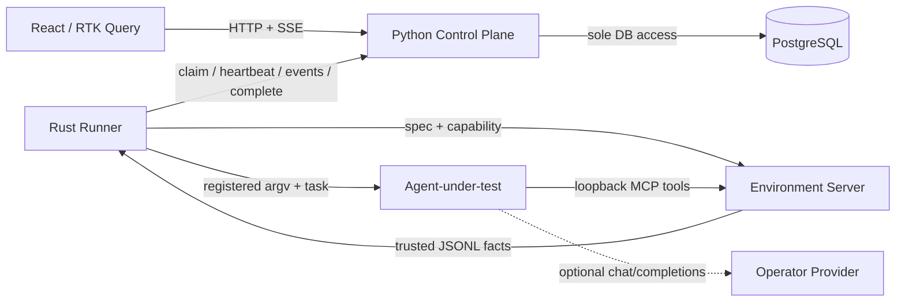

<p align="center">
  <a href="README.md">English</a> · <a href="README.zh-CN.md">中文</a>
</p>

# AgentOps Workbench

**A self-hosted reliability harness for tool-using agents.** Run an operator-registered Agent against a deterministic, resettable Environment, inspect a rule-based failure analysis, and compare a candidate Policy with its baseline. A person—not the Agent or analyzer—decides whether to activate it.

The repository is `agent-ops-platform`; the product qualifier distinguishes it from the unrelated [AgentOps-AI SDK](https://github.com/AgentOps-AI/agentops).

```text
Experiment → Baseline → Trace → Analysis → Candidate Policy
           → Replay → Before / After → Human Activate or Reject
```

## Current scope

The H1 integration implements separate Environment/MCP and fixture/reference Agent processes, Rust supervision with lease/Attempt fencing, an operator TOML Agent registry, CP-owned scoring/completion, and four built-in Environments. Protocol v1 retains `scenario_id`; the three canonical worlds use **v2**, while `order-support.v1` keeps its own identity. Retired world v1 IDs are rejected, not aliased or migrated.

**Local option-1 H1 engineering closeout is complete for this worktree.** This is not release, hosted-CI, cold-cache, cross-platform, or public-deployment acceptance. The operator explicitly deferred real-local-model trace/analysis acceptance; no Ollama/vLLM or GPU result is claimed. H2 external adapters, H3 repeated trials/**pass^k**, H4 **OTel export**, and H5 model-distribution accuracy studies are future work, not features of this checkout. See [tasks](docs/agents/phase2-tasks.md), [milestones](ROADMAP.md), and [acceptance boundaries](docs/operations/system-acceptance.md).

Langfuse and Phoenix store and explore traces well. This project instead owns the deterministic world, supervised execution/recovery, failure mechanics, and human Policy gate. Future interoperability is defined in ADR-0011; there is no current OTel exporter. Calibration is a deterministic six-contract mechanics gate, **not a published accuracy result**.

## Local fixture quickstart

Requirements: Docker with Compose and Make. No model, GPU, cloud API key, or external service is required for fixture execution.

```bash
cp .env.example .env
make demo
```

Replace the example `RUNNER_TOKEN` before use outside local development. API and Runner must receive the same explicit token. Demo database credentials are local-only; trusted-network deployment requires a separate secret/access review. Do not expose the stack publicly.

Open [http://localhost:5173](http://localhost:5173): create an Experiment, observe the failed baseline, inspect Analysis, replay the candidate, then Activate or Reject. Checkout's canonical path is `checkout-api-latency.v2`: baseline repeats logs six times; replay follows health → metrics → logs and succeeds in three world calls. The first activation may queue eligible RegressionCase replays; review them and explicitly activate again afterward.

```bash
make logs      # API, Runner, Web logs
make down      # stop the stack; preserve named volumes
```

## Agents and optional model configuration

`GET /api/agents` returns metadata, never commands. Normal `config/agents.toml` registers:

| Agent ID | Role |
|---|---|
| `fixture-agent.v1` | Deterministic MCP decisions; default fixture/CI path |
| `reference-openai-compatible.v1` | MCP tool loop using Runner-only OpenAI-compatible configuration |

Omitted `agent_id` selects by `execution_mode`; explicit registered IDs win and unknown IDs fail closed. The browser cannot supply argv, Provider URLs, models, or credentials. See the [registry runbook](docs/operations/agent-registry.md).

For an **already installed**, operator-managed Provider, configure only the Runner:

```bash
AGENTOPS_PROVIDER_BASE_URL=http://127.0.0.1:11434/v1
AGENTOPS_PROVIDER_API_KEY=local-placeholder
AGENTOPS_PROVIDER_MODEL=qwen3:8b
AGENTOPS_PROVIDER_TIMEOUT_MS=60000
AGENTOPS_PROVIDER_MAX_RETRIES=1
```

These are configuration examples, not verified model results. `127.0.0.1` refers to the Runner's network namespace: a container must have a separately verified route to a Windows/host service. Do not broaden listening or disable firewalls to make the example work. Start with modest context/concurrency; VRAM includes weights **and** KV cache. The [local-model handoff](docs/operations/local-model.md) defines the deferred acceptance and connectivity checks. CI uses fake Providers, never downloads models.

## Architecture and trust



- CP alone owns persistence, assertion scoring, Run terminal state, and authoritative completion ACKs. Rust is not a second scorer.
- Agent stdout is bounded diagnostics, never trusted world evidence. Environment-owned final-check operands are validated against CP-registered expectations.
- Success requires valid submit/check evidence, registered aggregate `>= 1.0`, and no overriding execution failure. EOF, exit zero, readiness, HTTP 200, and local eligibility alone are insufficient.
- Events persist before SSE; contiguous sequences, idempotent retry, Job → Run locking, and lease fencing protect recovery.
- One CSPRNG capability per logical Run survives replacement via a protected named handoff volume. Delete it only after a validated authoritative ACK.
- Linux/WSL children share a process group; cancellation uses TERM, a shared two-second grace, then KILL. JSONL lines and combined output are bounded.
- The host and operator registry are trusted. File validation is not a sandbox against malicious same-user processes.
- Provider usage remains Agent-reported; missing telemetry stays unknown. Credentials, endpoint values, and hidden reasoning are not persisted.
- Policy activation always requires successful positive replay, eligible RegressionCase success, and explicit human action.

See [domain invariants](CONTEXT.md), [architecture](docs/agentops_closed_loop_architecture.md), and [ADRs](docs/adr/).

## Recorded Preview

```bash
cd frontend
npm ci
VITE_MOCK_API=true npm run dev
```

**Recorded Demo Data** identifies this offline UI adapter. The checked-in checkout fixture comes from actual canonical v2 baseline/replay execution; only IDs and bounded lifecycle timestamps are normalized. Nullable usage stays nullable, and the accepted `submit_result` control is retained exactly once per Run. TypeScript does not reimplement scoring, analysis, or state transitions. Preview is not live-model evidence or a hosted service.

## Verification

```bash
make test-backend       # run from backend/ internally
make test-frontend
make test-rust
make fmt-check
make check-contracts

# Against a fresh, isolated running stack
python3 scripts/golden_e2e.py
# Destructive to that stack's Runner process only: kills and recreates it
python3 scripts/recovery_e2e.py

cd frontend && npm run e2e:recorded
```

Use Linux Node 22, Python 3.12, Rust 1.96, PostgreSQL 16, and locked dependencies for the CI baseline. PostgreSQL tests require fresh owned databases; SQLite/skips are not concurrency evidence. The [runbook](docs/operations/reliability-and-local-validation.md) covers toolchain, proxies, recursive Runner dependency admission, calibration/restore, and evidence limits.

`make check-contracts` exports then compares schemas to Git's index. During an intentionally uncommitted protocol cutover it reports the expected v1→v2 default delta. This is **not a green gate**: review generated bytes against current Pydantic models separately and rerun the unchanged gate on an authorized delivery baseline. Do not revert v2, stage, or weaken the gate to hide it.

Historical Phase 1 hosted CI passed on `8bd2ef0`; it does not validate this H1 worktree. Standard local Runner build/runtime, offline-derived images, host tests, actual volume replacement, and live models are separate claims. The current local closeout has parent evidence for the standard network-built image and fresh volume replacement; it does not claim hosted CI, cold-cache/fresh-base reproducibility, or live-model success. [Current acceptance](docs/operations/system-acceptance.md) separates these from [dated history](docs/history/).

## Repository and reading map

| Path | Purpose |
|---|---|
| `backend/` | CP, Environment server, independent Agents, migrations and tests |
| `runner/` | Rust protocol, Runner and CLI |
| `frontend/` | Four-route workbench and Recorded Preview |
| `contracts/v1/` | Python-owned generated schemas and cross-language fixtures |
| `config/` | Normal registry and explicit recovery-gate registry |
| `infra/docker/`, `scripts/` | Local stack and bounded integration gates |
| [docs/learn/](docs/learn/README.md) | Chinese learning path tied to code |
| [docs/operations/](docs/operations/README.md) | Repeatable operator procedures |
| [docs/agents/](docs/agents/development-standards.md) | Contributor standards and the single task list |
| [docs/history/](docs/history/README.md) | Dated, non-binding implementation history |

## Non-goals

No tracing SaaS, accounts, multi-tenancy, billing, Kubernetes, Docker-socket execution, untrusted code sandbox, vector memory, training export, LLM-as-judge, automatic activation, new Trace UI, annotation queues, or dataset management. MCP is a loopback Environment transport, not an open tool bus. Deployment and shared/public access require the roadmap's safety gate.

## License

MIT — see [LICENSE](LICENSE).
