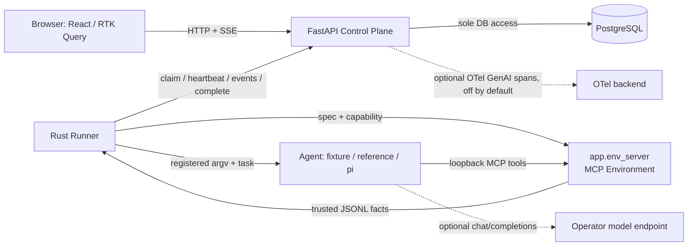
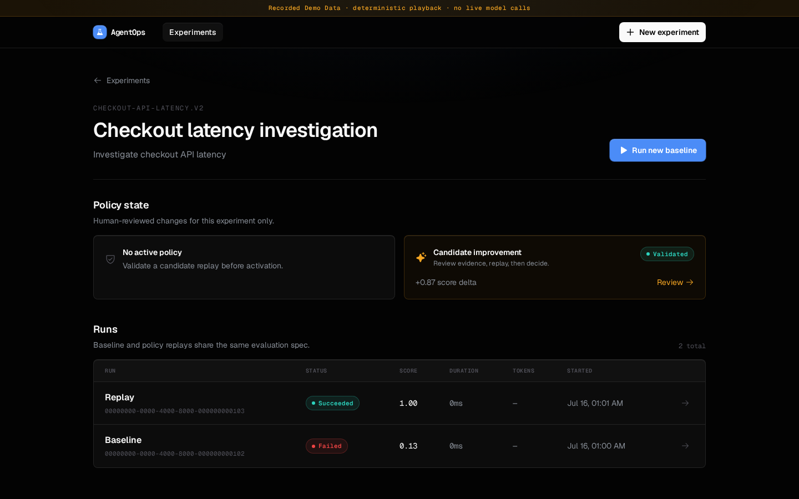
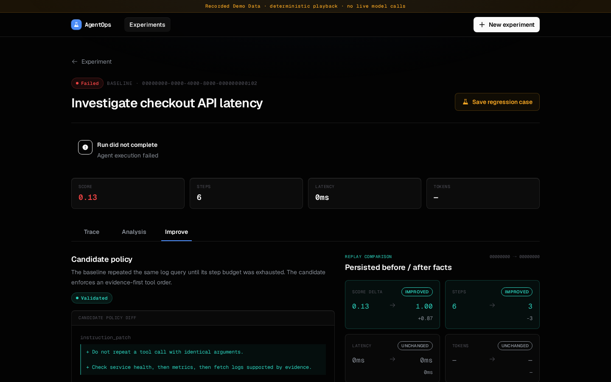

<p align="center">
  <a href="README.md">English</a> · <a href="README.zh-CN.md">中文</a>
</p>

# AgentOps Workbench

**A self-hosted reliability harness for tool-using agents.** Run an operator-registered Agent (a deterministic fixture, a reference OpenAI-compatible loop, or the external pi coding agent) against a deterministic, resettable Environment. Get pass^k over repeated trials, a rule-based failure analysis, and a candidate-Policy comparison against its baseline. A person, not the Agent or analyzer, decides whether to activate a Policy.

The repository is `agent-ops-platform`; the product qualifier distinguishes it from the unrelated [AgentOps-AI SDK](https://github.com/AgentOps-AI/agentops).

```text
Experiment → Baseline → Trace → Analysis → Candidate Policy
           → Replay → Before / After → Human Activate or Reject
```

## Quickstart

Requirements: Docker with Compose and Make. The fixture path needs no model, GPU, cloud API key, or external service.

```bash
cp .env.example .env
make demo
```

Open [http://localhost:5173](http://localhost:5173): create an Experiment, observe the failed baseline, inspect Analysis, replay the candidate, then Activate or Reject. Checkout's canonical path is `checkout-api-latency.v2`: baseline repeats logs six times; replay follows health → metrics → logs and succeeds in three world calls. The first activation may queue eligible RegressionCase replays; review them and explicitly activate again afterward.

```bash
make logs      # API, Runner, Web logs
make down      # stop the stack; preserve named volumes
```

The user running `make` must be able to reach the Docker daemon (on Linux, membership in the `docker` group). If the API times out connecting to the database or published ports do not respond, see [local environment faults](docs/operations/reliability-and-local-validation.md#wsl-proxy-and-local-verification-boundary) before debugging code.

Replace the example `RUNNER_TOKEN` before use outside local development. API and Runner must receive the same explicit token. Demo database credentials are local-only; trusted-network deployment requires a separate secret/access review. Do not expose the stack publicly.

## Local-model path

You need an **already installed**, operator-managed OpenAI-compatible endpoint; this repo installs no runtime or model. With the stack from the quickstart:

1. Set the Runner-only variables (the API key comes from your own secret source):

   ```bash
   AGENTOPS_PROVIDER_BASE_URL=http://127.0.0.1:8080/v1
   AGENTOPS_PROVIDER_API_KEY=<from your secret source>
   AGENTOPS_PROVIDER_MODEL=swift-1.5-27b-iq3xxs
   AGENTOPS_PROVIDER_TIMEOUT_MS=60000
   AGENTOPS_PROVIDER_MAX_RETRIES=1
   # Optional; blank/unset omits each field. Check endpoint support first.
   AGENTOPS_PROVIDER_MAX_TOKENS=256
   AGENTOPS_PROVIDER_TEMPERATURE=0
   AGENTOPS_PROVIDER_REASONING_EFFORT=none
   AGENTOPS_PROVIDER_PARALLEL_TOOL_CALLS=false
   ```

2. Restart the Runner so it picks them up.
3. In the UI, run an Experiment with `reference-openai-compatible.v1`.

This is the setup the acceptance runs exercised: a Windows-native llama.cpp service. **Ollama is not verified by this repo's acceptance runs.** An untested example: `AGENTOPS_PROVIDER_BASE_URL=http://127.0.0.1:11434/v1` with `AGENTOPS_PROVIDER_MODEL=qwen3:8b`.

`127.0.0.1` refers to the Runner's network namespace: a container needs a separately verified route to a Windows/host service. Do not broaden listening or disable firewalls to make it work. Start with modest context/concurrency; VRAM includes weights **and** KV cache. The [local-model runbook](docs/operations/local-model.md) covers direct setup, bounded generation settings and `scripts/local_model_acceptance.py`; the [dated record](docs/history/h1-live-model-acceptance-2026-11-01.md) states actual llama.cpp results. CI uses fake Providers and never downloads models.

## Agents

`GET /api/agents` returns metadata, never commands. Normal `config/agents.toml` registers:

| Agent ID | Role |
|---|---|
| `fixture-agent.v1` | Deterministic MCP decisions; default fixture/CI path |
| `reference-openai-compatible.v1` | MCP tool loop using Runner-only OpenAI-compatible configuration |
| `pi-coding-agent.v1` | External pi 1.3.0 on a host Runner; opt-in registry (`config/agents.external.toml`), see [plug in your agent](docs/learn/03-plug-in-your-agent.md) |

Omitted `agent_id` selects by `execution_mode`; explicit registered IDs win and unknown IDs fail closed. The browser cannot supply argv, Provider URLs, models, or credentials. See the [registry runbook](docs/operations/agent-registry.md).

## Architecture and trust



- CP alone owns persistence, assertion scoring, Run terminal state, and authoritative completion ACKs. Rust is not a second scorer.
- Agent stdout is bounded diagnostics, never trusted world evidence. Environment-owned final-check operands are validated against CP-registered expectations.
- Success requires valid submit/check evidence, registered aggregate `>= 1.0`, and no overriding execution failure. EOF, exit zero, readiness, HTTP 200, and local eligibility alone are insufficient.
- Events persist before SSE; contiguous sequences, idempotent retry, Job → Run locking, and lease fencing protect recovery.
- One CSPRNG capability per logical Run survives replacement via a protected named handoff volume. Delete it only after a validated authoritative ACK.
- Linux/WSL children share a process group; cancellation uses TERM, a shared two-second grace, then KILL. JSONL lines and combined output are bounded.
- The host and operator registry are trusted. File validation is not a sandbox against malicious same-user processes.
- Provider usage remains Agent-reported; missing telemetry stays unknown. Credentials, endpoint values, and hidden reasoning are not persisted.
- Policy activation always requires successful positive replay, eligible RegressionCase success, and explicit human action.

See [domain invariants](CONTEXT.md), [architecture](docs/agentops_closed_loop_architecture.md), and [ADRs](docs/adr/).

## Screenshots

Recorded Preview, dark theme, no backend.

| | |
|---|---|
| [Experiments](docs/screenshots/current-experiments.png) | Experiments list with latest Run status and score |
| [Experiment detail](docs/screenshots/current-experiment-detail.png) | Policy state (no active policy, validated candidate) and the Experiment's Runs |
| [Run: Trace](docs/screenshots/current-run-trace.png) | Failed baseline Run, Trace view showing the first tool step |
| [Run: Analysis](docs/screenshots/current-run-analysis.png) | Same Run, Analysis view with failure classifications and dominant failure |
| [Run: Improve](docs/screenshots/current-run-improve.png) | Candidate policy diff and before/after replay comparison |




## pass^k result: read with care

One model, one endpoint: the Windows llama.cpp service (build `b12018`), alias `swift-1.5-27b-iq3xxs`, context 8192. Each cell is one trial group with **n = 5** trials and **k = 5**, Environment seed 42, fresh PostgreSQL, host control plane and Rust Runner. Main example: `temperature=1`, `max_tokens=256`, `reasoning_effort=none`, `parallel_tool_calls=false`, and a per-Run sampler seed (`AGENTOPS_PROVIDER_SEED=per-run`), `reference-openai-compatible.v1`, run on 2026-11-07 ([record](docs/history/h3-pass-k-seed-2026-11-07.md)):

| Agent | Environment | successes | pass^1 | pass^5 | distinct trajectories |
|---|---|---|---|---|---|
| reference | research | 5/5 | 1.0 | 1.0 | 1 |
| reference | fault | 2/5 | 0.4 | 0.0 | 3 |
| reference | checkout | 0/5 | 0.0 | 0.0 | 1 |
| reference | order | 5/5 | 1.0 | 1.0 | 1 |

With independent sampling the fault trials diverged into 3 trajectories (before, 0/5 with 1 trajectory). Research, checkout and order still produced one trajectory per group, so on those tasks the model's choices are stable rather than copies caused by the seed. Fault shows pass^1 0.4 against pass^5 0.0: occasional success is not reliable success.

**Temperature 0 overstates reliability.** At temperature 0 every group repeated one trajectory, so pass^5 equals pass^1 ([record](docs/history/h3-pass-k-live-2026-11-04.md)): reference research 5/5 and fault 0/5, pi research 5/5 and fault 5/5, all with pass^5 equal to pass^1. At temperature 1 the server's pinned default sampler seed still made the reference Agent's trials copies ([record](docs/history/h3-pass-k-temp1-2026-11-05.md)). The per-Run seed is what gives independent trials. All of this is one model, one Environment seed and n = 5: not pass rates, not accuracy results, and not evidence about other models. See [pass^k](docs/learn/06-pass-k.md).

## Why not Langfuse/Phoenix?

Langfuse, Phoenix, Braintrust and similar products already store and render traces, datasets and replay diffs well, and this project does not rebuild a trace UI. What stays scarce for self-hosted users is a reproducible harness that runs **external** agents against resettable environments and reports pass^k, with a deterministic failure taxonomy and a human Policy gate. When enabled, the Control Plane exports OTel GenAI spans (off by default; see [OTel export](docs/operations/otel-export.md)), so those tools can consume the traces. One Run's trace was received by a local Phoenix (root `invoke_agent` span plus 8 `execute_tool` children; local Phoenix needed `PHOENIX_ENABLE_AUTH=false`); see [OTel mapping](docs/learn/07-otel-mapping.md) and `docs/screenshots/otel-phoenix.png`. This project no longer presents itself as a general evaluation platform.

## Current scope

H1 provides separate Environment/MCP and fixture/reference Agent processes, Rust supervision with lease/Attempt fencing, an operator TOML Agent registry, CP-owned scoring/completion, and four built-in Environments. Protocol v1 retains `scenario_id`; the three canonical worlds use **v2**, while `order-support.v1` keeps its own identity. Retired world v1 IDs are rejected, not aliased or migrated.

**H1 local engineering and real-model integration acceptance are complete**: the installed Windows llama.cpp service completed research and stateful order Runs through the reference Agent; checkout/fault failures are retained. Hosted CI passed on `b32da25`. This is not universal model compatibility, release, cold-cache, cross-platform, or public-deployment acceptance. **H2-1 is complete** (`pi-coding-agent.v1`). **H3 is complete** (trial groups with pass^k on the Experiment page, `POST /api/experiments/{id}/trials`). **H4 is complete** (optional OTel GenAI span export, verified against a local Phoenix). H5 model-distribution accuracy studies and the other optional external adapters are not done and are not features of this checkout. Calibration is a deterministic six-contract mechanics gate, **not a published accuracy result**. See [tasks](docs/agents/phase2-tasks.md), [milestones](ROADMAP.md), [ADR-0011](docs/adr/0011-otel-genai-export.md) for interoperability, and [acceptance boundaries](docs/operations/system-acceptance.md).

## Recorded Preview

```bash
cd frontend
npm ci
VITE_MOCK_API=true npm run dev
```

**Recorded Demo Data** identifies this offline UI adapter. The checked-in checkout fixture comes from actual canonical v2 baseline/replay execution; only IDs and bounded lifecycle timestamps are normalized. Nullable usage stays nullable, and the accepted `submit_result` control is retained exactly once per Run. TypeScript does not reimplement scoring, analysis, or state transitions. Preview is not live-model evidence or a hosted service.

## Verification

```bash
make test-backend       # run from backend/ internally
make test-frontend
make test-rust
make fmt-check
make check-contracts

# Against a fresh, isolated running stack
python3 scripts/golden_e2e.py
# Destructive to that stack's Runner process only: kills and recreates it
python3 scripts/recovery_e2e.py

cd frontend && npm run e2e:recorded
```

Use Linux Node 22, Python 3.12, Rust 1.96, PostgreSQL 16, and locked dependencies for the CI baseline. PostgreSQL tests require fresh owned databases; SQLite/skips are not concurrency evidence. The [runbook](docs/operations/reliability-and-local-validation.md) covers toolchain, proxies, recursive Runner dependency admission, calibration/restore, and evidence limits.

`make check-contracts` exports then compares schemas to Git's index. Keep this gate unchanged and rerun it before delivery; do not revert v2 or stage generated differences merely to hide drift.

Hosted CI for H1 passed on `b32da25`; historical Phase 1 hosted CI passed on `8bd2ef0` and does not validate H1. None of this claims cold-cache/fresh-base reproducibility. [Current acceptance](docs/operations/system-acceptance.md) separates these claims from [dated history](docs/history/).

## Repository and reading map

| Path | Purpose |
|---|---|
| `backend/` | CP, Environment server, independent Agents, migrations and tests |
| `runner/` | Rust protocol, Runner and CLI |
| `frontend/` | Four-route workbench and Recorded Preview |
| `contracts/v1/` | Python-owned generated schemas and cross-language fixtures |
| `config/` | Normal registry and explicit recovery-gate registry |
| `infra/docker/`, `scripts/` | Local stack and bounded integration gates |
| [docs/learn/](docs/learn/README.md) | Chinese learning path tied to code |
| [docs/operations/](docs/operations/README.md) | Repeatable operator procedures |
| [docs/agents/](docs/agents/development-standards.md) | Contributor standards and the single task list |
| [docs/history/](docs/history/README.md) | Dated, non-binding implementation history |

## Non-goals

No tracing SaaS, accounts, multi-tenancy, billing, Kubernetes, Docker-socket execution, untrusted code sandbox, vector memory, training export, LLM-as-judge, automatic activation, new Trace UI, annotation queues, or dataset management. MCP is a loopback Environment transport, not an open tool bus. Deployment and shared/public access require the roadmap's safety gate.

The Trace UI is frozen. H3 shows trial-group pass^1/pass^k and per-trial status on the Experiment page only; the Trace, Analysis and Improve views gain no new views.

## License

MIT — see [LICENSE](LICENSE).
