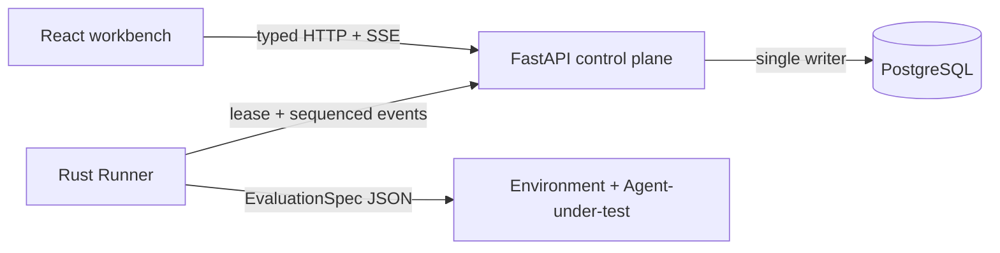
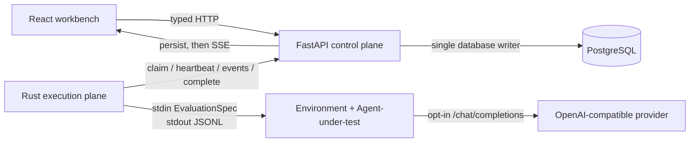

<p align="center">
  <a href="README.md">English</a> ·
  <a href="README.zh-CN.md">中文</a>
</p>

# AgentOps Workbench

**A self-hosted reliability harness for tool-using agents, built for people who run their own models.** Put an agent into a deterministic, resettable tool environment, run it repeatedly, and get back pass^k, a rule-based failure classification, and a Before/After regression comparison for any policy change — with a human gate before anything is activated. It runs on a single machine or a trusted team network; no data leaves the host. The repo name is `agent-ops-platform`; **AgentOps Workbench** is the product qualifier so this project is not confused with the unrelated [AgentOps-AI](https://github.com/AgentOps-AI/agentops) SDK.

**Why this exists when Langfuse and Phoenix are free:** they are good at storing and viewing traces and datasets, and this project deliberately does not compete there (the trace UI is frozen; traces can be exported to them, see ADR-0011). It owns the parts they leave to you: a supervised runner with lease recovery and attempt fencing, deterministic environments with fault injection, a closed failure taxonomy whose agreement with human labels is measured and published, and a gate that never auto-applies a policy.

```text
Experiment → Baseline → Trace → Failure Analysis → Candidate Policy
           → Replay → Before / After → Human Activate or Reject
```



**Why this repo is different:** (1) **Lease recovery with attempt fencing** — a crashed Runner cannot strand a Run; a replacement claims with a new Attempt and resumes from the next event sequence. (2) **Cross-language contract v1** — Python Pydantic, TypeScript Zod, and Rust Serde validate the same golden fixtures in CI. (3) A **deterministic failure taxonomy with a calibration gate**: the analyzer is rule-based, regression-tested in CI against six controlled fault contracts, and its agreement with human labels is reported rather than assumed.

**Local quick start:**

```bash
cp .env.example .env
make demo
```

The example `.env` contains a local-demo `RUNNER_TOKEN`; replace it before running outside local development. Compose requires an explicit token for both API and Runner.

Open [http://localhost:5173](http://localhost:5173) and walk the Golden loop: create an Experiment, watch the baseline fail, review Analysis, replay the candidate Policy, then Activate or Reject.

**Status (2026-10-17):** Phase 1 — the closed loop above on three built-in Environments (formerly Scenarios) and the built-in Python agent — is complete and CI-verified (`8bd2ef0`, six jobs green). Phase 2 — Harness is in progress: it splits the Environment from the Agent-under-test so external agents (a reference agent on local Ollama/vLLM models, Claude Code, the OpenAI Agents SDK, or your own loop) can be evaluated in the same environments over MCP; adds trial groups with pass^k; and exports traces as OpenTelemetry GenAI spans for Langfuse or Phoenix. Until Phase 2 stage H1 lands, only the built-in agent runs. See [ROADMAP.md](ROADMAP.md) and ADR-0007 to ADR-0011.

## Deterministic Golden workflow

The built-in scenario investigates checkout API latency:

1. The baseline repeatedly fetches the same logs, exhausts its six-step budget, and fails.
2. The rule-based analyzer identifies controlled failure types and metric directions from persisted event evidence.
3. The failed Run can be saved as a deterministic RegressionCase with its Scenario, seed, and parameters.
4. AgentOps proposes a typed policy patch: avoid duplicate calls and check health, then metrics, then evidence-backed logs.
5. The same evaluation spec and seed are replayed through the Rust Runner; Improve shows persisted score, analysis, step, latency, token, and trajectory differences.
6. Activation first replays eligible RegressionCases. The candidate remains inert until a person reviews those results and explicitly selects **Activate** again or rejects it.

No LLM key or external service is required.

## Optional OpenAI-compatible provider

Fixture execution remains the default, deterministic CI and Golden path. An Experiment may instead select `provider`; the API and browser still send only that mode. The Runner alone receives the operator configuration:

```bash
AGENTOPS_PROVIDER_BASE_URL=https://provider.example/v1
AGENTOPS_PROVIDER_API_KEY=replace-me
AGENTOPS_PROVIDER_MODEL=scenario-model
AGENTOPS_PROVIDER_TIMEOUT_MS=10000
AGENTOPS_PROVIDER_MAX_RETRIES=1
```

With Compose, place these values in the ignored `.env` file and run `make demo`; only the `runner` service receives them. Select **OpenAI-compatible provider** when creating the Experiment. The Python boundary calls `/chat/completions`, exposes only the selected Scenario's explicit tool set, honors timeout/retry/cancellation, and records safe model, latency, request-count, and token metrics. Checkout, multi-step research, and API fault orchestration each have their own bounded tool definitions and deterministic observations. Credentials, endpoints, and hidden reasoning are never persisted. Missing or failed configuration produces a structured terminal Run error. CI uses local fake compatible servers; live-provider checks are explicitly opt-in.

## Run the real stack

Requirements: Docker with Compose and Make.

```bash
cp .env.example .env
make demo
```

Open [http://localhost:5173](http://localhost:5173). The Golden loop normally completes in under 30 seconds.

```bash
make logs      # follow API, Runner, and Web
make down      # stop the stack
make test      # backend, frontend, Rust, and contract checks
```

## Live stack vs recorded preview

| Mode | Purpose | What runs |
|---|---|---|
| Local live stack | Real end-to-end behavior | React, FastAPI, PostgreSQL, Rust Runner, fixture or opt-in provider-backed Python agent |
| Recorded preview | Offline UI development and deterministic regression checks | React plus recorded Golden E2E fixtures |

Start the recorded preview with:

```bash
cd frontend
npm ci
VITE_MOCK_API=true npm run dev
```

The UI displays **Recorded Demo Data** in this mode. Fixtures replay persisted events in order; they do not reimplement scoring, analysis, policy compilation, or state transitions in TypeScript. Recorded Preview is an offline development and regression adapter; public hosting is outside the current milestone.

## Architecture



| Layer | Responsibility |
|---|---|
| React + RTK Query | Experiment workflow, durable Trace, Analysis, Improve, replay comparison, human decision |
| FastAPI | Experiments, run and policy state machines, leases, persistence, scoring, analysis, SSE |
| Rust Runner | Process groups, heartbeat/cancel, timeout, bounded JSONL, event retry, terminal cleanup |
| PostgreSQL | Experiments, runs, jobs, ordered events, analyses, policies, and regression cases |
| Python agent | Registered Scenario handlers with deterministic fixtures and narrow, scenario-specific opt-in Provider paths |

Python Pydantic models own protocol v1. Versioned JSON Schemas and Golden fixtures live in [contracts/v1](contracts/v1); Rust Serde types validate those same fixtures in CI.

The [Phase 2 target architecture](docs/agentops_closed_loop_architecture.md#phase-2-target-architecture) describes how external agents attach over MCP while the control plane stays unchanged.

The [closed-loop architecture](docs/agentops_closed_loop_architecture.md) explains component ownership, Runner recovery and attempt fencing, registered Scenarios, cross-language contracts, and the human activation gate. Accepted boundary decisions are recorded in [docs/adr](docs/adr).

## Reliability and trust boundaries

- FastAPI is the only component that reads or writes PostgreSQL.
- Events are committed before they are published over SSE.
- Reconnects use `after=<sequence>`; `run_id + sequence` is unique and uploads are idempotent.
- Runner APIs require a bearer token and validate the runner identity, lease, and run.
- Expired leases cannot append events or complete a non-terminal run; repeated terminal completion remains idempotent.
- RegressionCase creation is unique per source Run; concurrent requests converge on the same case.
- Policy replay uses an atomic `replay_run_id` claim; concurrent requests converge on one Replay Run and RunnerJob.
- Eligible RegressionCases are replayed against each candidate Policy; a terminal replay owned by another Policy is not reused.
- Heartbeat, event upload, and completion fence the RunnerJob lease; recovery cannot let an old lease write a later Attempt.
- Terminal completion uses a status compare-and-set; only the winner performs terminal scoring, analysis, and candidate-policy side effects.
- When a lease expires, the next authenticated claim increments the Attempt, fences the old lease, and resumes from the next event sequence.
- Jobs select an allowlisted `scenario_id`; API clients can select only `fixture` or `provider` execution and cannot provide an executable, shell command, provider URL, model, or credential.
- The Runner alone receives provider configuration. Provider calls are bounded, cancelable `/chat/completions` requests and can select only the registered tool definitions for the chosen Scenario.
- Latest-attempt Provider model identity, latency, request count, and token usage are persisted as Run metrics; credentials, endpoint values, and hidden reasoning are not.
- Runner commands and arguments are separate. It never connects to Docker or the database.
- JSONL lines are capped at 64 KiB and combined output at 1 MiB by default.
- Linux/WSL jobs run in their own process group; cancellation sends SIGTERM, then SIGKILL after two seconds.
- Product events expose `decision_summary`, never hidden chain-of-thought.
- Policy activation always requires a successful positive replay, successful eligible RegressionCase replays, and an explicit human action after reviewing those results.

## Product surface

Only four routes form the Phase 1 product:

```text
/experiments
/experiments/new
/experiments/:experimentId
/runs/:runId?view=trace|analysis|improve
```

Run states are explicit: `queued`, `claimed`, `running`, `cancelling`, `succeeded`, `failed`, `cancelled`, and `timed_out`.

## Repository map

```text
backend/      FastAPI control plane, Alembic migrations, fixture and provider Python agent
frontend/     React workbench and recorded-preview adapter
runner/       Rust workspace: protocol, runner, and CLI
contracts/    Versioned JSON Schemas and cross-language Golden fixtures
infra/docker/ Focused local Compose stack
scripts/      Real-stack Golden E2E
docs/learn/     Reading path for understanding the system (Chinese)
docs/history/   Dated verification and calibration records moved out of living docs
docs/agents/    Contributor and agent guides, development standards
docs/adr/     Architecture decisions
LICENSE         MIT
ROADMAP.md    Current engineering milestones and promotion gates
```

## Verification

```bash
make check-contracts
make test-backend
make test-frontend
make test-rust
make fmt-check

# Against a running real stack
python3 scripts/golden_e2e.py

# Only against an isolated, disposable Compose stack; this kills and recreates its Runner
python3 scripts/recovery_e2e.py

# With Linux Node 22, npm dependencies, and Playwright Chromium installed
cd frontend && npm run e2e:recorded
```

CI covers Python, migrations, TypeScript, frontend formatting and Recorded browser E2E, Rust protocol/process supervision, Compose validation, Golden loops, and Runner recovery. See the [local validation runbook](docs/operations/reliability-and-local-validation.md) for the WSL toolchain and proxy setup.

The [current-version system acceptance](docs/operations/system-acceptance.md) records the 2026-10-15 local engineering result: 265 backend tests with PostgreSQL enabled and no skips, 34 frontend unit tests, two Recorded E2E tests, and Rust fmt/Clippy/workspace tests passed. Refreshed standard images passed all three Golden Scenarios, real checkout browser workflow and regression activation gate, interrupted-stream reconnection, cancellation, Runner recovery, stale-lease fencing and application backup/restore. Source hashes match committed code; no application source mounts were used, and Docker cache was allowed. Acceptance fixed a PostgreSQL lock-order deadlock and missing named SSE subscriptions. One non-blocking regression-card refresh limitation is documented; GitHub Actions on `8bd2ef0` subsequently passed all six jobs. Historical evidence is indexed in [docs/history/](docs/history/) ([phase 1 verification log](docs/history/phase1-verification-log.md), [calibration evidence log](docs/history/calibration-evidence-log.md)).

The rule-based failure analyzer is regression-tested in CI by a six-contract controlled capture (measured/unknown context pressure; fake-provider success, timeout, invalid response) that restores a real PostgreSQL dump and checks a strictly bound report; this is a mechanics gate, not an accuracy claim. Phase 2 H5 adds an agreement study: the author labels ~40 real Runs from local models and external agents and publishes the confusion matrix with its known biases (self-labeling is stated as a limitation). See the [calibration procedure](docs/evaluation-calibration.md).

## Deliberate non-goals

Not a tracing SaaS and not a general evaluation platform. No accounts, multi-tenancy or billing; no Kubernetes or Docker-socket execution; no vector memory or training export; no LLM-as-judge; no automatic policy activation; no new trace-UI features, annotation queues or dataset management. MCP is used only as the loopback transport between a supervised agent and a built-in Environment (ADR-0008); registered agents run on the Runner host within the single-machine scope (ADR-0009). See [ROADMAP.md](ROADMAP.md) for the deferred list and the safety gate.

## Project direction

The 2026-10-17 review found trace UI, dataset versioning, replay diff and failed-run promotion to be commodity in Langfuse, Phoenix and Braintrust, while a harness that runs external agents in deterministic environments and reports calibrated failure classes is not; Phase 2 therefore invests in the runner, the environments, the taxonomy and interoperability (OTel), and freezes the UI. See [ROADMAP.md](ROADMAP.md) Phase 2.

## Learning path

[docs/learn/README.md](docs/learn/README.md) is the ordered reading path (Chinese).

[docs/agents/development-standards.md](docs/agents/development-standards.md) defines the Phase 2 conventions.

[docs/adr/](docs/adr/) holds decisions.

## License

MIT — see [LICENSE](LICENSE).
