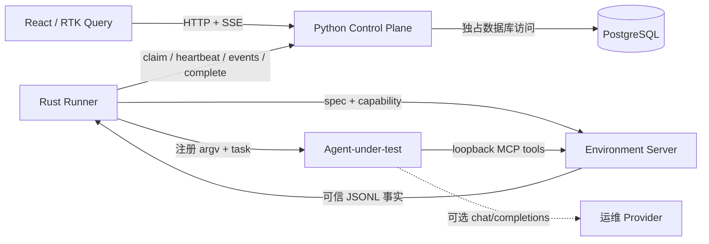

<p align="center">
  <a href="README.md">English</a> · <a href="README.zh-CN.md">中文</a>
</p>

# AgentOps Workbench

**面向工具型 Agent 的自托管可靠性试验台。** 让运维注册的 Agent 在确定、可重置的 Environment 中运行，查看规则化失败分析，对比候选 Policy 与 baseline，最后由人决定是否激活；Agent 和分析器都不能自动激活策略。

仓库名为 `agent-ops-platform`；产品限定名用于区别无关的 [AgentOps-AI SDK](https://github.com/AgentOps-AI/agentops)。

```text
Experiment → Baseline → Trace → Analysis → Candidate Policy
           → Replay → Before / After → 人工 Activate 或 Reject
```

## 当前范围

H1 集成已实现独立的 Environment/MCP 与 fixture/reference Agent 进程、Rust 租约/Attempt fencing 监督、运维 TOML Agent 注册表、CP 独占评分/完成裁决，以及四个内置 Environment。协议 v1 仍用 `scenario_id`；三个规范世界使用 **v2**，`order-support.v1` 保持自己的身份。旧三个世界 v1 ID 被拒绝，不提供别名或迁移。

**当前工作树的本地 option-1 H1 工程收尾已完成。** 这不等于发布、hosted CI、cold-cache、跨平台或公开部署验收。操作者已明确延期真实本地模型的 trace/分析验收；不声称 Ollama/vLLM 或 GPU 验证成功。H2 外部适配器、H3 重复 trial/**pass^k**、H4 **OTel 导出**、H5 真实模型分布准确率研究均是未来工作，不是当前功能。参见[任务清单](docs/agents/phase2-tasks.md)、[里程碑](ROADMAP.zh-CN.md)与[验收边界](docs/operations/system-acceptance.md)。

Langfuse、Phoenix 擅长 trace 存储与浏览；本项目负责确定性世界、监督执行/恢复、失败机制和人工策略门禁。未来互操作见 ADR-0011，当前没有 OTel exporter。校准是六合同确定性机制门，**不是已发布的准确率结论**。

## 本地 fixture 快速启动

需要 Docker Compose 与 Make。Fixture 不需要模型、GPU、云 API Key 或外部服务。

```bash
cp .env.example .env
make demo
```

本地开发以外必须替换示例 `RUNNER_TOKEN`，API 与 Runner 接收同一个显式 Token。演示数据库凭据仅限本地；可信内网部署也需单独的 Secret/访问审查，不要公开暴露服务。

打开 [http://localhost:5173](http://localhost:5173)：创建 Experiment，观察 baseline 失败，查看 Analysis，Replay 候选，然后 Activate 或 Reject。规范 checkout 为 `checkout-api-latency.v2`：baseline 重复六次 logs，replay 按 health → metrics → logs 三次世界调用成功。第一次激活可能先排队 RegressionCase replay；审查后须再次显式激活。

```bash
make logs      # API、Runner、Web 日志
make down      # 停止栈，保留 named volumes
```

## Agent 与可选模型配置

`GET /api/agents` 只返回元数据，不返回命令。正常 `config/agents.toml` 注册：

| Agent ID | 职责 |
|---|---|
| `fixture-agent.v1` | 确定性 MCP 决策；fixture/CI 默认路径 |
| `reference-openai-compatible.v1` | 使用 Runner 配置的 OpenAI-compatible Provider 的 MCP 工具循环 |

省略 `agent_id` 时按 `execution_mode` 选择；显式注册 ID 优先，未知 ID fail closed。浏览器不能提供 argv、Provider 地址、模型或凭据。见[注册表 runbook](docs/operations/agent-registry.md)。

对于**已经安装**、由操作者管理的 Provider，只配置 Runner：

```bash
AGENTOPS_PROVIDER_BASE_URL=http://127.0.0.1:11434/v1
AGENTOPS_PROVIDER_API_KEY=local-placeholder
AGENTOPS_PROVIDER_MODEL=qwen3:8b
AGENTOPS_PROVIDER_TIMEOUT_MS=60000
AGENTOPS_PROVIDER_MAX_RETRIES=1
```

这是配置示例，不是已验证模型结果。`127.0.0.1` 指 Runner 自己的网络命名空间；容器到 Windows/宿主机服务的路由必须另行验证，不要为此扩大监听或关闭防火墙。先用适中 context/并发，显存预算包含权重**和** KV cache。[本地模型交接](docs/operations/local-model.md)定义延期验收与连通性检查。CI 使用 fake Provider，不下载模型。

## 架构与信任边界



- CP 独占持久化、断言评分、Run 终态与权威 completion ACK；Rust 不是第二评分器。
- Agent stdout 仅为有界诊断，不是世界证据；Environment 所有的 final-check operands 必须通过 CP 注册 expectations 校验。
- 成功需要有效 submit/check、注册 aggregate `>= 1.0` 且无覆盖性的执行失败；EOF、exit 0、ready、HTTP 200、本地 eligible 都不充分。
- 事件先持久化后 SSE；连续序列、幂等重试、Job → Run 锁顺序与 lease fencing 保护恢复。
- 每个 logical Run 的 CSPRNG capability 通过受保护 named handoff volume 跨替换保留；仅有效权威 ACK 后删除。
- Linux/WSL 子进程共享进程组；取消使用 TERM、共享两秒 grace、再 KILL。JSONL 单行和合并输出都有界。
- 宿主机和注册表可信；文件校验不是隔离恶意同用户进程的沙箱。
- usage 仍是 Agent-reported，缺失保持 unknown；凭据、endpoint 值和隐藏推理不持久化。
- Policy 激活始终需要成功正分差 replay、合格 RegressionCase 成功，以及显式人工操作。

详见[领域不变量](CONTEXT.md)、[架构](docs/agentops_closed_loop_architecture.md)与 [ADR](docs/adr/)。

## Recorded Preview

```bash
cd frontend
npm ci
VITE_MOCK_API=true npm run dev
```

**Recorded Demo Data** 标明离线 UI adapter。当前 checkout fixture 来自真正的规范 v2 baseline/replay；仅规范化 IDs 和受 Run 生命周期约束的时间戳。Nullable usage 不伪造，accepted `submit_result` control 每个 Run 恰好保留一次。TypeScript 不重做评分、分析或状态机。Preview 不是 live-model 证据，也不是托管服务。

## 验证

```bash
make test-backend       # 内部从 backend/ 执行
make test-frontend
make test-rust
make fmt-check
make check-contracts

# 针对全新、隔离、已启动的栈
python3 scripts/golden_e2e.py
# 仅用于该隔离栈：终止并重建其 Runner
python3 scripts/recovery_e2e.py

cd frontend && npm run e2e:recorded
```

CI 基线为 Linux Node 22、Python 3.12、Rust 1.96、PostgreSQL 16 与锁定依赖。PostgreSQL 专项必须用全新独占库；SQLite/skip 不能替代并发证据。[本地 runbook](docs/operations/reliability-and-local-validation.md)说明工具链、代理、Runner 递归依赖验证、校准/恢复和证据边界。

`make check-contracts` 导出 schema 后与 Git index 对比；未提交的规范切换会报告预期的 v1→v2 默认值差异。这**不是 gate 全绿**：应另核对生成字节与当前 Pydantic 模型，并在获准的交付基线上重跑原 gate。不要为掩盖差异回退 v2、stage 或削弱检查。

历史 Phase 1 hosted CI 在 `8bd2ef0` 通过，不验证当前 H1 工作树。标准本地 Runner 构建/运行、离线派生镜像、host 测试、实际 volume 替换和真实模型都是不同声明。当前本地收尾有标准网络构建镜像与全新 volume 替换的父证据，但不声称 hosted CI、cold-cache/fresh-base 可复现或真实模型成功。[当前验收](docs/operations/system-acceptance.md)与[带日期历史](docs/history/)分开记录。

## 仓库与阅读地图

| 路径 | 职责 |
|---|---|
| `backend/` | CP、Environment server、独立 Agent、迁移与测试 |
| `runner/` | Rust protocol、Runner、CLI |
| `frontend/` | 四路由工作台与 Recorded Preview |
| `contracts/v1/` | Python 所有的 schema 与跨语言 fixture |
| `config/` | 正常注册表与显式 recovery gate 注册表 |
| `infra/docker/`、`scripts/` | 本地栈与有界集成门 |
| [docs/learn/](docs/learn/README.md) | 对应真实代码的中文学习路径 |
| [docs/operations/](docs/operations/README.md) | 可重复的运维操作 |
| [docs/agents/](docs/agents/development-standards.md) | 开发规范和唯一任务清单 |
| [docs/history/](docs/history/README.md) | 带日期、非当前约束的历史记录 |

## 明确不做

不做 tracing SaaS、账号、多租户、计费、Kubernetes、Docker socket 执行、不可信代码沙箱、向量记忆、训练导出、LLM-as-judge、自动激活、新 Trace UI、标注队列或 dataset 管理。MCP 是 loopback Environment transport，不是开放工具总线。部署和共享/公网访问需通过 roadmap 的安全门。

## License

MIT — 见 [LICENSE](LICENSE)。
