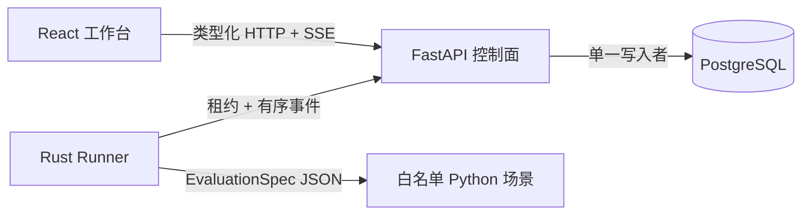
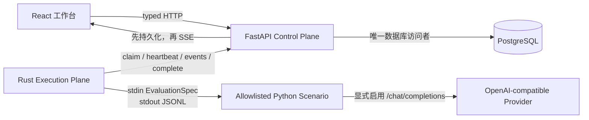

<p align="center">
  <a href="README.md">English</a> ·
  <a href="README.zh-CN.md">中文</a>
</p>

# AgentOps Workbench

**面向工具型 Agent 的工程化闭环评估工作台** — 创建 Experiment、审查持久化 Trace、诊断失败、回放候选 Policy，并决定是否激活。目标部署范围是单机或可信团队内网。仓库名为 `agent-ops-platform`；对外使用 **AgentOps Workbench** 作为产品限定名，避免与无关的 [AgentOps-AI](https://github.com/AgentOps-AI/agentops) SDK 或泛称 “agent ops” 混淆。

与 Langfuse、Phoenix 等不同，本工作台强调完整的 **策略回放 + 人工激活门禁** 闭环——候选策略不会自动生效。

```text
Experiment → Baseline → Trace → Failure Analysis → Candidate Policy
           → Replay → Before / After → 人工 Activate 或 Reject
```



**本仓库的两个差异点：** (1) **带 Attempt 隔离的租约恢复** — Runner 崩溃不会让 Run 永久卡住；替换 Runner 以新 Attempt 领取并从下一事件序列继续。(2) **跨语言 contract v1** — Python Pydantic、TypeScript Zod 与 Rust Serde 在 CI 中校验同一套 golden fixtures。

**本地快速启动：**

```bash
cp .env.example .env
make demo
```

示例 `.env` 中的 `RUNNER_TOKEN` 仅供本地演示；在本地开发之外运行前须替换。Compose 要求为 API 和 Runner 显式提供同一个 Token。

打开 [http://localhost:5173](http://localhost:5173)，走完 Golden 闭环：创建 Experiment、观察 baseline 失败、查看 Analysis、回放候选 Policy，然后 Activate 或 Reject。

Phase 1 至 **Phase 1.4 — 场景接入** 已完成：三个注册内置 Scenario 均支持确定性 Fixture 与窄边界、场景专属的 Provider 路径。闭环同时具备确定性失败归类、持久化 Before/After 对比，以及人工激活前的回归用例重放。详见 [ROADMAP.zh-CN.md](ROADMAP.zh-CN.md)。

## 确定性 Golden 流程

内置场景用于调查 checkout API 延迟：

1. Baseline 重复读取相同日志，耗尽六步预算后失败。
2. 确定性规则分析器依据持久化事件证据识别受控失败类型与指标方向。
3. 失败 Run 可连同 Scenario、Seed 与参数保存为确定性 RegressionCase。
4. AgentOps 生成一个有类型约束的候选策略：禁止相同调用重复，依次检查 health、metrics 和证据相关 logs。
5. Rust Runner 使用相同 EvaluationSpec 与 Seed 发起 Replay；Improve 展示持久化的分数、分析、步骤、延迟、Token 与轨迹差异。
6. 激活会先重放所有符合条件的 RegressionCase。Candidate 不会自动生效；操作者审查结果后必须再次显式选择 **Activate**，或拒绝它。

整个流程不需要 LLM Key，也不依赖外部服务。

## 可选 OpenAI-compatible Provider

Fixture 仍是默认的确定性 CI 与 Golden 路径。Experiment 也可以选择 `provider`；API 和浏览器只会发送这个模式，Provider 的运行配置只存在于 Runner：

```bash
AGENTOPS_PROVIDER_BASE_URL=https://provider.example/v1
AGENTOPS_PROVIDER_API_KEY=replace-me
AGENTOPS_PROVIDER_MODEL=scenario-model
AGENTOPS_PROVIDER_TIMEOUT_MS=10000
AGENTOPS_PROVIDER_MAX_RETRIES=1
```

使用 Compose 时，把这些值写入被忽略的 `.env`，然后执行 `make demo`；只有 `runner` 服务会接收它们。创建 Experiment 时选择 **OpenAI-compatible provider**。Python 边界只调用 `/chat/completions`，并且只暴露所选 Scenario 的显式工具集，同时支持 timeout、有限重试与取消，并持久化安全的模型、延迟、请求次数和 Token 指标。Checkout、多步检索与 API 故障编排分别拥有各自的有界工具定义和确定性 observation；凭证、endpoint 与隐藏推理不会持久化。配置缺失或 Provider 失败会产生结构化的 Run 终态错误。CI 使用本地 fake compatible server，真实 Provider 检查必须显式开启。

## 启动真实闭环

需要 Docker Compose 与 Make。

```bash
cp .env.example .env
make demo
```

打开 [http://localhost:5173](http://localhost:5173)。Golden 闭环通常会在 30 秒内完成。

```bash
make logs      # 查看 API、Runner 与 Web 日志
make down      # 停止完整环境
make test      # 后端、前端、Rust 与契约测试
```

## 真实环境与录制预览

| 模式 | 用途 | 实际运行内容 |
|---|---|---|
| 本地真实环境 | 验证完整端到端行为 | React、FastAPI、PostgreSQL、Rust Runner、Fixture 或显式启用的 Provider Python Agent |
| Recorded Preview | 离线 UI 开发与确定性回归检查 | React 与 Golden E2E 录制 fixtures |

启动 Recorded Preview：

```bash
cd frontend
npm ci
VITE_MOCK_API=true npm run dev
```

此模式会持续显示 **Recorded Demo Data**。Fixture 只按时间顺序回放真实闭环中持久化的事件，不会在 TypeScript 中重新实现评分、分析、策略编译或状态机。Recorded Preview 用于离线开发和确定性回归检查；公网托管不属于当前里程碑。

## 架构



| 层 | 职责 |
|---|---|
| React + RTK Query | Experiment 流程、可恢复 Trace、Analysis、Improve、Replay 对比与人工决策 |
| FastAPI | Experiment、Run/Policy 状态机、Lease、持久化、评分、分析和 SSE |
| Rust Runner | 进程组、Heartbeat/Cancel、Timeout、有界 JSONL、事件重试和退出清理 |
| PostgreSQL | Experiment、Run、Job、有序事件、Analysis、Policy 与 RegressionCase |
| Python Agent | 注册 Scenario Handler，提供确定性 Fixture 与窄边界、场景专属的 Provider 路径 |

Python Pydantic 类型是协议 v1 的事实来源。版本化 JSON Schema 与 Golden fixtures 位于 [contracts/v1](contracts/v1)，Rust Serde 类型在 CI 中验证同一批 fixtures。

[闭环架构文档](docs/agentops_closed_loop_architecture.md)解释组件职责、Runner 租约恢复与 Attempt 隔离、注册 Scenario、跨语言 contract，以及人工激活门禁。已接受的边界决策见 [docs/adr](docs/adr)。

## 可靠性与安全边界

- FastAPI 是 PostgreSQL 的唯一读写者。
- RunEvent 提交成功后才会通过 SSE 发布。
- 重连使用 `after=<sequence>`；`run_id + sequence` 唯一，重复上传幂等。
- Runner API 使用 Bearer Token，并校验 runner identity、lease 与 run。
- 过期 Lease 不能继续上报或完成非终态任务；终态重复完成仍保持幂等。
- RegressionCase 按源 Run 在数据库中唯一约束；并发创建请求会汇聚到同一条用例。
- Policy Replay 通过原子 `replay_run_id` 抢占；并发请求只会保留一个 Replay Run 与 RunnerJob。
- 每个候选 Policy 都必须针对符合条件的 RegressionCase 重新 Replay；其他 Policy 已完成的 Replay 不会被复用。
- Heartbeat、事件上传和完成操作会隔离 RunnerJob Lease；恢复流程不会让旧 Lease 写入后续 Attempt。
- 终态完成使用基于已观察 Run 状态的 CAS；只有获胜请求执行终态评分、分析和候选 Policy 副作用。
- Lease 过期后，下一次认证 claim 会递增 Attempt、隔离旧 Lease，并从下一个事件 Sequence 继续。
- Job 只包含白名单 `scenario_id`；API 用户只可选择 `fixture` 或 `provider`，不能提交 executable、shell 命令、Provider URL、模型或凭证。
- Provider 配置只传入 Runner。Provider 调用是有界、可取消的 `/chat/completions` 请求，并且只能选择所选 Scenario 注册的工具定义。
- 最新 Attempt 的 Provider 模型标识、延迟、请求次数和 token 用量会写入 Run metrics；凭证、endpoint 与隐藏推理不会写入。
- Runner 分离 command 与 args，不连接 Docker daemon，也不直连数据库。
- JSONL 单行默认最多 64 KiB，总输出默认最多 1 MiB。
- Linux/WSL 子进程运行在独立进程组；取消时先 SIGTERM，两秒后 SIGKILL。
- 产品事件仅展示 `decision_summary`，不记录或暗示隐藏 Chain-of-Thought。
- Policy 必须在主 Replay 分数提升、符合条件的 RegressionCase Replay 成功后，由人审查结果并显式激活。

## 产品范围

Phase 1 只保留四个产品路由：

```text
/experiments
/experiments/new
/experiments/:experimentId
/runs/:runId?view=trace|analysis|improve
```

Run 状态明确区分 `queued`、`claimed`、`running`、`cancelling`、`succeeded`、`failed`、`cancelled` 和 `timed_out`。

## 仓库结构

```text
backend/      FastAPI Control Plane、Alembic migrations、Fixture 与 Provider Python Agent
frontend/     React 工作台与 Recorded Preview Adapter
runner/       Rust workspace：protocol、runner、CLI
contracts/    版本化 JSON Schema 与跨语言 Golden fixtures
infra/docker/ 聚焦后的本地 Compose 环境
scripts/      真实环境 Golden E2E
docs/adr/     架构决策
ROADMAP.zh-CN.md 当前工程里程碑与能力提升门槛
```

## 验证

```bash
make check-contracts
make test-backend
make test-frontend
make test-rust
make fmt-check

# 面向已启动的真实环境
python3 scripts/golden_e2e.py

# 仅面向隔离、可丢弃的 Compose 环境；脚本会终止并重建其中的 Runner
python3 scripts/recovery_e2e.py

# 需安装 Linux Node 22、npm 依赖和 Playwright Chromium
cd frontend && npm run e2e:recorded
```

CI 覆盖 Python、数据库迁移、TypeScript、前端格式与 Recorded 浏览器 E2E、Rust 协议与进程监督、Compose 配置、Golden 闭环及 Runner 恢复。WSL 工具链与代理设置见[本地验证 runbook](docs/operations/reliability-and-local-validation.md)。

按日期记录的验证证据见 [ROADMAP.zh-CN.md](ROADMAP.zh-CN.md)和[校准流程](docs/evaluation-calibration.md)。2026-10-15 此前标准镜像验收时，标准 Runner 构建及隔离标准四服务 Compose 栈通过全部三个 Golden Scenario 和 Runner 终止/替换恢复；API/Runner 的 Python 源码摘要与该次验收记录的源码快照一致，没有源码挂载。基础镜像和 API/Web 层使用 Docker 缓存；Runner 已完成 Rust 编译与锁定 Python 依赖安装，最终源码刷新复用了该次依赖层。当前后端通过 262 项测试，无跳过，宿主机上的 PostgreSQL 校准采集/恢复 gate 也已通过。此前前端证据包括 27 项单测及 2 项 Recorded E2E。此前源码快照的 backend 与 recovery CI 步骤也已在本地复现。这些宿主机检查不将此前镜像验收扩展到当前源码快照，当前提交尚无新的托管 CI 结果。

只读校准工具从终态 Run 导出分析盲审 packet，并将单独标注的标签与根据持久化 RunEvent 重建的预测进行比较。当前六案例受控 packet 覆盖已测量/未知 context 及回环 Fake Provider 的成功、超时和无效响应；标签显式标记未知维度，绑定报告采用 `failure-analyzer.v2` 并展示已评估覆盖率。它仍仅是临时工程机制证据，`publishable_accuracy=false`。独立人评与争议裁决仍待完成；这不阻塞确定性工程开发，也不构成可发布的 precision/recall/F1。最新计数和验证待办以链接中的证据记录为准。

## 明确不做

Phase 1 不包含 Kubernetes Executor、Docker Socket、MCP Server、向量记忆、Training Export、多框架适配、用户提供的 Provider endpoint 或凭证、任意代码执行、账户、多租户、计费或自动激活 Policy。

这些能力继续暂缓，只有可量化需求才能将其提升到主线。Phase 1.4 与闭环深化后续均已完成，详见 [ROADMAP.zh-CN.md](ROADMAP.zh-CN.md)。

## 项目方向

AgentOps 将持续打磨为可靠的闭环评测系统。工程优先级由可恢复执行、持久状态、明确不变量、跨语言类型契约、可观测故障和安全进程监督决定，而不是由功能数量决定。

## License

MIT
