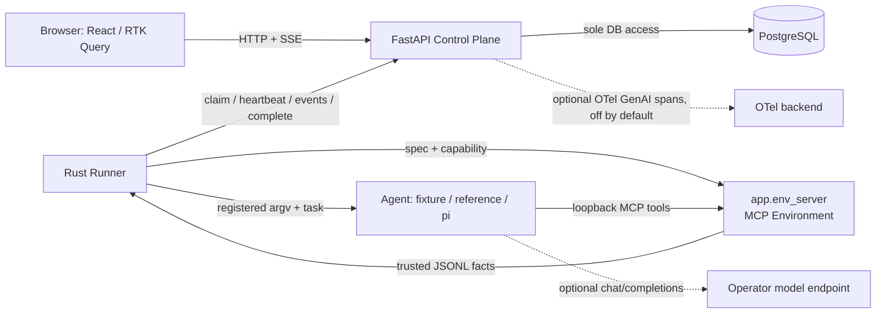
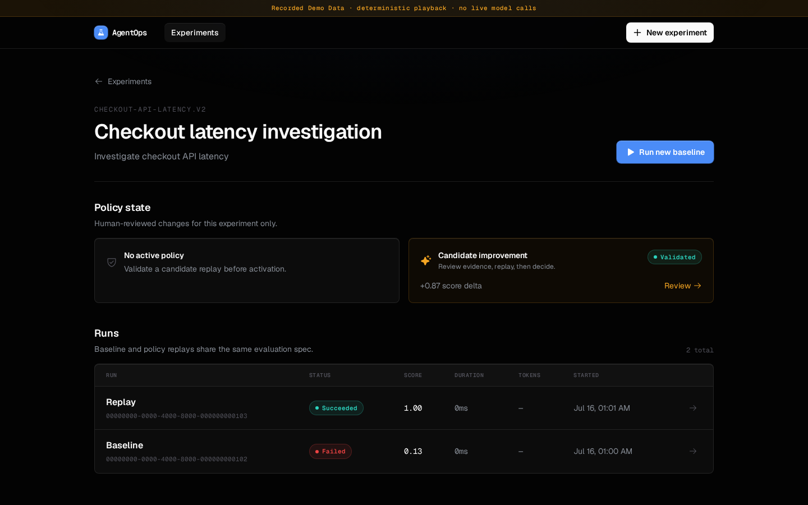
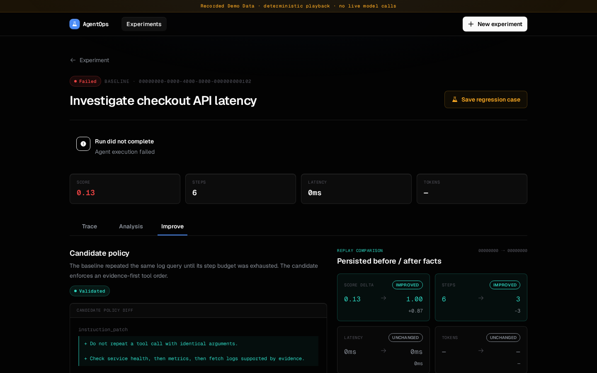

<p align="center">
  <a href="README.md">English</a> · <a href="README.zh-CN.md">中文</a>
</p>

# AgentOps Workbench

**面向工具型 Agent 的自托管可靠性试验台。** 让运维注册的 Agent（确定性 fixture、参考 OpenAI-compatible 循环，或外部 pi coding agent）在确定、可重置的 Environment 中运行。得到重复 trial 的 pass^k、规则化失败分析，以及候选 Policy 与 baseline 的对比。是否激活 Policy 由人决定，Agent 和分析器都不能决定。

仓库名为 `agent-ops-platform`；产品限定名用于区别无关的 [AgentOps-AI SDK](https://github.com/AgentOps-AI/agentops)。

```text
Experiment → Baseline → Trace → Analysis → Candidate Policy
           → Replay → Before / After → 人工 Activate 或 Reject
```

## 快速启动

需要 Docker Compose 与 Make。fixture 路径不需要模型、GPU、云 API Key 或外部服务。

```bash
cp .env.example .env
make demo
```

打开 [http://localhost:5173](http://localhost:5173)：创建 Experiment，观察 baseline 失败，查看 Analysis，Replay 候选，然后 Activate 或 Reject。规范 checkout 为 `checkout-api-latency.v2`：baseline 重复六次 logs，replay 按 health → metrics → logs 三次世界调用成功。第一次激活可能先排队合格的 RegressionCase replay；审查后须再次显式激活。

```bash
make logs      # API、Runner、Web 日志
make down      # 停止栈，保留 named volumes
```

运行 `make` 的用户必须能访问 Docker daemon（Linux 上即属于 `docker` 组）。若 API 连接数据库超时或发布端口无响应，先看[本地环境故障](docs/operations/reliability-and-local-validation.md#wsl-proxy-and-local-verification-boundary)再排查代码。

本地开发以外必须替换示例 `RUNNER_TOKEN`，API 与 Runner 接收同一个显式 Token。演示数据库凭据仅限本地；可信内网部署也需单独的 Secret/访问审查，不要公开暴露服务。

## 本地模型路径

需要一个**已经安装**、由操作者管理的 OpenAI-compatible 端点；本仓库不安装运行时或模型。在快速启动的栈上：

1. 设置只给 Runner 的变量（API key 来自你自己的密钥来源）：

   ```bash
   AGENTOPS_PROVIDER_BASE_URL=http://127.0.0.1:8080/v1
   AGENTOPS_PROVIDER_API_KEY=<from your secret source>
   AGENTOPS_PROVIDER_MODEL=swift-1.5-27b-iq3xxs
   AGENTOPS_PROVIDER_TIMEOUT_MS=60000
   AGENTOPS_PROVIDER_MAX_RETRIES=1
   # 可选；空值/未设置时不发送。先确认端点支持。
   AGENTOPS_PROVIDER_MAX_TOKENS=256
   AGENTOPS_PROVIDER_TEMPERATURE=0
   AGENTOPS_PROVIDER_REASONING_EFFORT=none
   AGENTOPS_PROVIDER_PARALLEL_TOOL_CALLS=false
   ```

2. 重启 Runner 使其生效。
3. 在 UI 中用 `reference-openai-compatible.v1` 运行 Experiment。

验收运行用的就是这套配置：Windows 原生 llama.cpp 服务。**本仓库的验收运行没有验证 Ollama。** 未经测试的示例：`AGENTOPS_PROVIDER_BASE_URL=http://127.0.0.1:11434/v1` 配 `AGENTOPS_PROVIDER_MODEL=qwen3:8b`。

`127.0.0.1` 指 Runner 自己的网络命名空间：容器到 Windows/宿主机服务的路由必须另行验证，不要为此扩大监听或关闭防火墙。先用适中 context/并发，显存预算包含权重**和** KV cache。[本地模型 runbook](docs/operations/local-model.md)提供直连配置、有界生成参数及 `scripts/local_model_acceptance.py`；[带日期的记录](docs/history/h1-live-model-acceptance-2026-11-01.md)说明实际 llama.cpp 结果。CI 使用 fake Provider，不下载模型。

## Agents

`GET /api/agents` 只返回元数据，不返回命令。正常 `config/agents.toml` 注册：

| Agent ID | 职责 |
|---|---|
| `fixture-agent.v1` | 确定性 MCP 决策；fixture/CI 默认路径 |
| `reference-openai-compatible.v1` | 使用 Runner 配置的 OpenAI-compatible Provider 的 MCP 工具循环 |
| `pi-coding-agent.v1` | 宿主机 Runner 上的外部 pi 1.3.0；可选注册表（`config/agents.external.toml`），见[接入你自己的 Agent](docs/learn/03-plug-in-your-agent.md) |

省略 `agent_id` 时按 `execution_mode` 选择；显式注册 ID 优先，未知 ID fail closed。浏览器不能提供 argv、Provider 地址、模型或凭据。见[注册表 runbook](docs/operations/agent-registry.md)。

## 架构与信任边界



- CP 独占持久化、断言评分、Run 终态与权威 completion ACK；Rust 不是第二评分器。
- Agent stdout 仅为有界诊断，不是世界证据；Environment 所有的 final-check operands 必须通过 CP 注册 expectations 校验。
- 成功需要有效 submit/check、注册 aggregate `>= 1.0` 且无覆盖性的执行失败；EOF、exit 0、ready、HTTP 200、本地 eligible 都不充分。
- 事件先持久化后 SSE；连续序列、幂等重试、Job → Run 锁顺序与 lease fencing 保护恢复。
- 每个 logical Run 的 CSPRNG capability 通过受保护 named handoff volume 跨替换保留；仅有效权威 ACK 后删除。
- Linux/WSL 子进程共享进程组；取消使用 TERM、共享两秒 grace、再 KILL。JSONL 单行和合并输出都有界。
- 宿主机和注册表可信；文件校验不是隔离恶意同用户进程的沙箱。
- usage 仍是 Agent-reported，缺失保持 unknown；凭据、endpoint 值和隐藏推理不持久化。
- Policy 激活始终需要成功正分差 replay、合格 RegressionCase 成功，以及显式人工操作。

详见[领域不变量](CONTEXT.md)、[架构](docs/agentops_closed_loop_architecture.md)与 [ADR](docs/adr/)。

## 截图

Recorded Preview，深色主题，无后端。

| | |
|---|---|
| [Experiments](docs/screenshots/current-experiments.png) | Experiment 列表，含最近 Run 状态和分数 |
| [Experiment detail](docs/screenshots/current-experiment-detail.png) | Policy 状态（无激活策略、已验证候选）与该 Experiment 的 Run |
| [Run: Trace](docs/screenshots/current-run-trace.png) | 失败的 baseline Run，Trace 视图显示第一步工具调用 |
| [Run: Analysis](docs/screenshots/current-run-analysis.png) | 同一 Run 的 Analysis 视图：失败分类与主导失败 |
| [Run: Improve](docs/screenshots/current-run-improve.png) | 候选 Policy diff 与 before/after replay 对比 |




## pass^k 结果：谨慎阅读

一个模型、一个端点：Windows llama.cpp 服务（build `b12018`），别名 `swift-1.5-27b-iq3xxs`，context 8192。每格是一个 trial group，**n = 5** 次 trial、**k = 5**，Environment seed 42，全新 PostgreSQL，宿主机 control plane 与 Rust Runner。主示例：`temperature=1`、`max_tokens=256`、`reasoning_effort=none`、`parallel_tool_calls=false`，并使用每 Run 采样 seed（`AGENTOPS_PROVIDER_SEED=per-run`），`reference-openai-compatible.v1`，2026-11-07 运行（[记录](docs/history/h3-pass-k-seed-2026-11-07.md)）：

| Agent | Environment | 成功 | pass^1 | pass^5 | 不同轨迹数 |
|---|---|---|---|---|---|
| reference | research | 5/5 | 1.0 | 1.0 | 1 |
| reference | fault | 2/5 | 0.4 | 0.0 | 3 |
| reference | checkout | 0/5 | 0.0 | 0.0 | 1 |
| reference | order | 5/5 | 1.0 | 1.0 | 1 |

有了独立采样，fault 的 trial 分化为 3 条轨迹（之前是 0/5、1 条轨迹）。research、checkout、order 每组仍只有一条轨迹，说明在这些任务上模型的选择本身是稳定的，而不是 seed 造成的复制。fault 的 pass^1 为 0.4、pass^5 为 0.0：偶尔成功不等于可靠成功。

**温度 0 会高估可靠性。** 温度 0 时每个组都重复同一条轨迹，pass^5 等于 pass^1（[记录](docs/history/h3-pass-k-live-2026-11-04.md)）：reference 的 research 5/5、fault 0/5，pi 的 research 5/5、fault 5/5，pass^5 全都等于 pass^1。温度 1 时服务端固定的默认采样 seed 仍让 reference Agent 的 trial 成为复制（[记录](docs/history/h3-pass-k-temp1-2026-11-05.md)）。每 Run seed 才带来独立 trial。以上都是一个模型、一个 Environment seed、n = 5：不是通过率，不是准确率结论，也不是其他模型的证据。见 [pass^k](docs/learn/06-pass-k.md)。

## 为什么不是 Langfuse/Phoenix？

Langfuse、Phoenix、Braintrust 等产品已经能很好地存储和展示 trace、数据集与 replay diff，本项目不重做 trace UI。对自托管用户仍稀缺的是：可对**外部** Agent 在可重置环境上复现运行并报告 pass^k 的 harness，加上确定性失败分类和人工 Policy 门禁。启用后，Control Plane 导出 OTel GenAI span（默认关闭；见 [OTel 导出](docs/operations/otel-export.md)），这些工具可以直接消费 trace。一个 Run 的 trace 已被本地 Phoenix 接收（根 `invoke_agent` span 加 8 个 `execute_tool` 子 span；本地 Phoenix 需要 `PHOENIX_ENABLE_AUTH=false`），见 [OTel 映射](docs/learn/07-otel-mapping.md)与 `docs/screenshots/otel-phoenix.png`。本项目不再以通用评估平台自居。

## 当前范围

H1 已实现独立的 Environment/MCP 与 fixture/reference Agent 进程、Rust 租约/Attempt fencing 监督、运维 TOML Agent 注册表、CP 独占评分/完成裁决，以及四个内置 Environment。协议 v1 仍用 `scenario_id`；三个规范世界使用 **v2**，`order-support.v1` 保持自己的身份。旧世界 v1 ID 被拒绝，不提供别名或迁移。

**H1 本地工程与真实模型集成验收已完成**：已安装的 Windows llama.cpp 经 reference Agent 完成 research 和有状态订单 Run；checkout/fault 失败如实保留。hosted CI 已在 `b32da25` 通过。这不等于所有模型兼容、发布、cold-cache、跨平台或公开部署验收。**H2-1 已完成**（`pi-coding-agent.v1`）。**H3 已完成**（trial group 与 Experiment 页的 pass^k，`POST /api/experiments/{id}/trials`）。**H4 已完成**（可选 OTel GenAI span 导出，已用本地 Phoenix 验证）。H5 模型分布准确率研究和其他可选外部适配器尚未完成，不是当前功能。校准是六合同确定性机制门，**不是已发布的准确率结论**。参见[任务清单](docs/agents/phase2-tasks.md)、[里程碑](ROADMAP.zh-CN.md)、互操作用的 [ADR-0011](docs/adr/0011-otel-genai-export.md)与[验收边界](docs/operations/system-acceptance.md)。

## Recorded Preview

```bash
cd frontend
npm ci
VITE_MOCK_API=true npm run dev
```

**Recorded Demo Data** 标明离线 UI adapter。当前 checkout fixture 来自真正的规范 v2 baseline/replay；仅规范化 IDs 和受 Run 生命周期约束的时间戳。Nullable usage 不伪造，accepted `submit_result` control 每个 Run 恰好保留一次。TypeScript 不重做评分、分析或状态机。Preview 不是 live-model 证据，也不是托管服务。

## 验证

```bash
make test-backend       # run from backend/ internally
make test-frontend
make test-rust
make fmt-check
make check-contracts

# Against a fresh, isolated running stack
python3 scripts/golden_e2e.py
# Destructive to that stack's Runner process only: kills and recreates it
python3 scripts/recovery_e2e.py

cd frontend && npm run e2e:recorded
```

CI 基线为 Linux Node 22、Python 3.12、Rust 1.96、PostgreSQL 16 与锁定依赖。PostgreSQL 专项必须用全新独占库；SQLite/skip 不能替代并发证据。[本地 runbook](docs/operations/reliability-and-local-validation.md)说明工具链、代理、Runner 递归依赖验证、校准/恢复和证据边界。

`make check-contracts` 导出 schema 后与 Git index 对比。保持该 gate 不变并在交付前重跑；不要为隐藏 drift 回退 v2 或 stage 生成差异。

H1 的 hosted CI 在 `b32da25` 通过；历史 Phase 1 hosted CI 在 `8bd2ef0` 通过，不验证 H1。以上都不声称 cold-cache/fresh-base 可复现。[当前验收](docs/operations/system-acceptance.md)与[带日期历史](docs/history/)分开记录。

## 仓库与阅读地图

| 路径 | 职责 |
|---|---|
| `backend/` | CP、Environment server、独立 Agent、迁移与测试 |
| `runner/` | Rust protocol、Runner、CLI |
| `frontend/` | 四路由工作台与 Recorded Preview |
| `contracts/v1/` | Python 所有的 schema 与跨语言 fixture |
| `config/` | 正常注册表与显式 recovery gate 注册表 |
| `infra/docker/`、`scripts/` | 本地栈与有界集成门 |
| [docs/learn/](docs/learn/README.md) | 对应真实代码的中文学习路径 |
| [docs/operations/](docs/operations/README.md) | 可重复的运维操作 |
| [docs/agents/](docs/agents/development-standards.md) | 开发规范和唯一任务清单 |
| [docs/history/](docs/history/README.md) | 带日期、非当前约束的历史记录 |

## 明确不做

不做 tracing SaaS、账号、多租户、计费、Kubernetes、Docker socket 执行、不可信代码沙箱、向量记忆、训练导出、LLM-as-judge、自动激活、新 Trace UI、标注队列或 dataset 管理。MCP 是 loopback Environment transport，不是开放工具总线。部署和共享/公网访问需通过 roadmap 的安全门。

Trace UI 已冻结。H3 只在 Experiment 页显示 trial group 的 pass^1/pass^k 和每个 trial 的状态；Trace、Analysis、Improve 不新增视图。

## License

MIT — 见 [LICENSE](LICENSE)。
