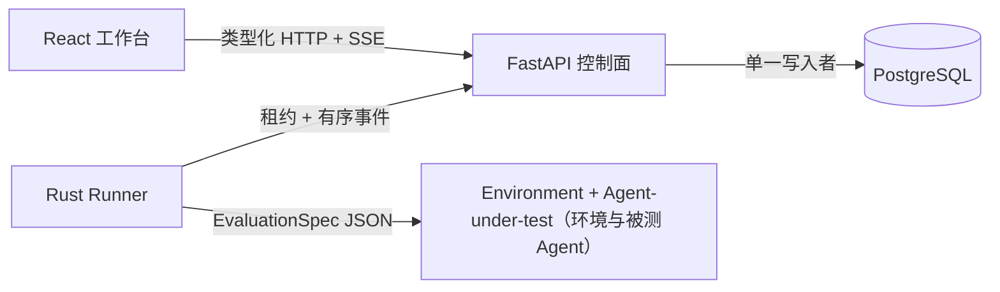
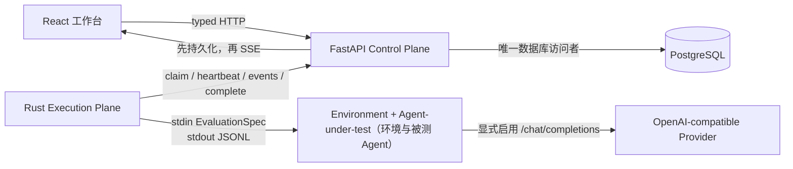

<p align="center">
  <a href="README.md">English</a> ·
  <a href="README.zh-CN.md">中文</a>
</p>

# AgentOps Workbench

**面向自托管场景的工具型 Agent 可靠性 Harness（harness），为自行运行模型的人而建。** 将 Agent 放入可确定、可重置的工具环境，反复运行，得到 pass^k、基于规则的失败分类，以及任意策略变更的 Before/After 回归对比——在任何东西被激活之前都有人工门禁。运行于单机或可信团队内网；数据不离开主机。仓库名为 `agent-ops-platform`；对外使用 **AgentOps Workbench** 作为产品限定名，避免与无关的 [AgentOps-AI](https://github.com/AgentOps-AI/agentops) SDK 混淆。

**Langfuse 与 Phoenix 免费时为何还需要本项目：** 它们擅长存储与查看 trace 与 dataset，本项目刻意不在此竞争（Trace UI 已冻结；trace 可导出到它们，见 ADR-0011）。本项目负责它们留给你的部分：带租约恢复与 Attempt 隔离的监督 Runner、可注入故障的确定性 Environment（环境）、封闭失败分类体系（其与人工标签的一致性会被测量并公开），以及从不自动应用策略的门禁。

```text
Experiment → Baseline → Trace → Failure Analysis → Candidate Policy
           → Replay → Before / After → 人工 Activate 或 Reject
```



**本仓库的差异点：** (1) **带 Attempt 隔离的租约恢复** — Runner 崩溃不会让 Run 永久卡住；替换 Runner 以新 Attempt 领取并从下一事件序列继续。(2) **跨语言 contract v1** — Python Pydantic、TypeScript Zod 与 Rust Serde 在 CI 中校验同一套 golden fixtures。(3) **确定性失败分类与校准门禁**：分析器为规则驱动，在 CI 中针对六个受控故障 contract 做回归测试；其与人工标签的一致性以报告形式公开，而非默认假定。

**本地快速启动：**

```bash
cp .env.example .env
make demo
```

示例 `.env` 中的 `RUNNER_TOKEN` 仅供本地演示；在本地开发之外运行前须替换。Compose 要求为 API 和 Runner 显式提供同一个 Token。

打开 [http://localhost:5173](http://localhost:5173)，走完 Golden 闭环：创建 Experiment、观察 baseline 失败、查看 Analysis、回放候选 Policy，然后 Activate 或 Reject。

**状态（2026-10-17）：** Phase 1 — 上文闭环在三个内置 Environment（原 Scenario）与内置 Python Agent 上 — 已完成并经 CI 验证（`8bd2ef0`，六项 job 全绿）。Phase 2 — Harness 进行中：将 Environment 与 Agent-under-test（被测 Agent）分离，使外部 Agent（本地 Ollama/vLLM 上的参考 Agent、Claude Code、OpenAI Agents SDK 或自有循环）可通过 MCP 在同一环境中评测；增加带 pass^k 的 trial group；并以 OpenTelemetry GenAI span 导出 trace 供 Langfuse 或 Phoenix 使用。在 Phase 2 阶段 H1 落地前，仅内置 Agent 可运行。见 [ROADMAP.zh-CN.md](ROADMAP.zh-CN.md) 与 ADR-0007 至 ADR-0011。

## 确定性 Golden 流程

内置场景用于调查 checkout API 延迟：

1. Baseline 重复读取相同日志，耗尽六步预算后失败。
2. 确定性规则分析器依据持久化事件证据识别受控失败类型与指标方向。
3. 失败 Run 可连同 Scenario、Seed 与参数保存为确定性 RegressionCase。
4. AgentOps 生成一个有类型约束的候选策略：禁止相同调用重复，依次检查 health、metrics 和证据相关 logs。
5. Rust Runner 使用相同 EvaluationSpec 与 Seed 发起 Replay；Improve 展示持久化的分数、分析、步骤、延迟、Token 与轨迹差异。
6. 激活会先重放所有符合条件的 RegressionCase。Candidate 不会自动生效；操作者审查结果后必须再次显式选择 **Activate**，或拒绝它。

整个流程不需要 LLM Key，也不依赖外部服务。

## 可选 OpenAI-compatible Provider

Fixture 仍是默认的确定性 CI 与 Golden 路径。Experiment 也可以选择 `provider`；API 和浏览器只会发送这个模式，Provider 的运行配置只存在于 Runner：

```bash
AGENTOPS_PROVIDER_BASE_URL=https://provider.example/v1
AGENTOPS_PROVIDER_API_KEY=replace-me
AGENTOPS_PROVIDER_MODEL=scenario-model
AGENTOPS_PROVIDER_TIMEOUT_MS=10000
AGENTOPS_PROVIDER_MAX_RETRIES=1
```

使用 Compose 时，把这些值写入被忽略的 `.env`，然后执行 `make demo`；只有 `runner` 服务会接收它们。创建 Experiment 时选择 **OpenAI-compatible provider**。Python 边界只调用 `/chat/completions`，并且只暴露所选 Scenario 的显式工具集，同时支持 timeout、有限重试与取消，并持久化安全的模型、延迟、请求次数和 Token 指标。Checkout、多步检索与 API 故障编排分别拥有各自的有界工具定义和确定性 observation；凭证、endpoint 与隐藏推理不会持久化。配置缺失或 Provider 失败会产生结构化的 Run 终态错误。CI 使用本地 fake compatible server，真实 Provider 检查必须显式开启。

## 启动真实闭环

需要 Docker Compose 与 Make。

```bash
cp .env.example .env
make demo
```

打开 [http://localhost:5173](http://localhost:5173)。Golden 闭环通常会在 30 秒内完成。

```bash
make logs      # 查看 API、Runner 与 Web 日志
make down      # 停止完整环境
make test      # 后端、前端、Rust 与契约测试
```

## 真实环境与录制预览

| 模式 | 用途 | 实际运行内容 |
|---|---|---|
| 本地真实环境 | 验证完整端到端行为 | React、FastAPI、PostgreSQL、Rust Runner、Fixture 或显式启用的 Provider Python Agent |
| Recorded Preview | 离线 UI 开发与确定性回归检查 | React 与 Golden E2E 录制 fixtures |

启动 Recorded Preview：

```bash
cd frontend
npm ci
VITE_MOCK_API=true npm run dev
```

此模式会持续显示 **Recorded Demo Data**。Fixture 只按时间顺序回放真实闭环中持久化的事件，不会在 TypeScript 中重新实现评分、分析、策略编译或状态机。Recorded Preview 用于离线开发和确定性回归检查；公网托管不属于当前里程碑。

## 架构



| 层 | 职责 |
|---|---|
| React + RTK Query | Experiment 流程、可恢复 Trace、Analysis、Improve、Replay 对比与人工决策 |
| FastAPI | Experiment、Run/Policy 状态机、Lease、持久化、评分、分析和 SSE |
| Rust Runner | 进程组、Heartbeat/Cancel、Timeout、有界 JSONL、事件重试和退出清理 |
| PostgreSQL | Experiment、Run、Job、有序事件、Analysis、Policy 与 RegressionCase |
| Python Agent | 注册 Scenario Handler，提供确定性 Fixture 与窄边界、场景专属的 Provider 路径 |

Python Pydantic 类型是协议 v1 的事实来源。版本化 JSON Schema 与 Golden fixtures 位于 [contracts/v1](contracts/v1)，Rust Serde 类型在 CI 中验证同一批 fixtures。

[Phase 2 目标架构](docs/agentops_closed_loop_architecture.md#phase-2-target-architecture)说明外部 Agent 如何通过 MCP 接入且控制面保持不变。

[闭环架构文档](docs/agentops_closed_loop_architecture.md)解释组件职责、Runner 租约恢复与 Attempt 隔离、注册 Scenario、跨语言 contract，以及人工激活门禁。已接受的边界决策见 [docs/adr](docs/adr)。

## 可靠性与安全边界

- FastAPI 是 PostgreSQL 的唯一读写者。
- RunEvent 提交成功后才会通过 SSE 发布。
- 重连使用 `after=<sequence>`；`run_id + sequence` 唯一，重复上传幂等。
- Runner API 使用 Bearer Token，并校验 runner identity、lease 与 run。
- 过期 Lease 不能继续上报或完成非终态任务；终态重复完成仍保持幂等。
- RegressionCase 按源 Run 在数据库中唯一约束；并发创建请求会汇聚到同一条用例。
- Policy Replay 通过原子 `replay_run_id` 抢占；并发请求只会保留一个 Replay Run 与 RunnerJob。
- 每个候选 Policy 都必须针对符合条件的 RegressionCase 重新 Replay；其他 Policy 已完成的 Replay 不会被复用。
- Heartbeat、事件上传和完成操作会隔离 RunnerJob Lease；恢复流程不会让旧 Lease 写入后续 Attempt。
- 终态完成使用基于已观察 Run 状态的 CAS；只有获胜请求执行终态评分、分析和候选 Policy 副作用。
- Lease 过期后，下一次认证 claim 会递增 Attempt、隔离旧 Lease，并从下一个事件 Sequence 继续。
- Job 只包含白名单 `scenario_id`；API 用户只可选择 `fixture` 或 `provider`，不能提交 executable、shell 命令、Provider URL、模型或凭证。
- Provider 配置只传入 Runner。Provider 调用是有界、可取消的 `/chat/completions` 请求，并且只能选择所选 Scenario 注册的工具定义。
- 最新 Attempt 的 Provider 模型标识、延迟、请求次数和 token 用量会写入 Run metrics；凭证、endpoint 与隐藏推理不会写入。
- Runner 分离 command 与 args，不连接 Docker daemon，也不直连数据库。
- JSONL 单行默认最多 64 KiB，总输出默认最多 1 MiB。
- Linux/WSL 子进程运行在独立进程组；取消时先 SIGTERM，两秒后 SIGKILL。
- 产品事件仅展示 `decision_summary`，不记录或暗示隐藏 Chain-of-Thought。
- Policy 必须在主 Replay 分数提升、符合条件的 RegressionCase Replay 成功后，由人审查结果并显式激活。

## 产品范围

Phase 1 只保留四个产品路由：

```text
/experiments
/experiments/new
/experiments/:experimentId
/runs/:runId?view=trace|analysis|improve
```

Run 状态明确区分 `queued`、`claimed`、`running`、`cancelling`、`succeeded`、`failed`、`cancelled` 和 `timed_out`。

## 仓库结构

```text
backend/      FastAPI Control Plane、Alembic migrations、Fixture 与 Provider Python Agent
frontend/     React 工作台与 Recorded Preview Adapter
runner/       Rust workspace：protocol、runner、CLI
contracts/    版本化 JSON Schema 与跨语言 Golden fixtures
infra/docker/ 聚焦后的本地 Compose 环境
scripts/      真实环境 Golden E2E
docs/learn/     理解系统的阅读路径（中文）
docs/history/   从活文档迁出的按日验证与校准记录
docs/agents/    贡献者与 Agent 指南、开发规范
docs/adr/     架构决策
LICENSE         MIT
ROADMAP.zh-CN.md 当前工程里程碑与能力提升门槛
```

## 验证

```bash
make check-contracts
make test-backend
make test-frontend
make test-rust
make fmt-check

# 面向已启动的真实环境
python3 scripts/golden_e2e.py

# 仅面向隔离、可丢弃的 Compose 环境；脚本会终止并重建其中的 Runner
python3 scripts/recovery_e2e.py

# 需安装 Linux Node 22、npm 依赖和 Playwright Chromium
cd frontend && npm run e2e:recorded
```

CI 覆盖 Python、数据库迁移、TypeScript、前端格式与 Recorded 浏览器 E2E、Rust 协议与进程监督、Compose 配置、Golden 闭环及 Runner 恢复。WSL 工具链与代理设置见[本地验证 runbook](docs/operations/reliability-and-local-validation.md)。

[当前版本系统验收](docs/operations/system-acceptance.md)记录 2026-10-15 本地工程结果：启用 PostgreSQL、无跳过的 265 项后端测试，34 项前端单测，两项 Recorded E2E，以及 Rust fmt/Clippy/workspace 测试通过。刷新后的标准镜像通过全部三个 Golden Scenario、真实 checkout 浏览器流程与回归激活门禁、中断流重连、取消、Runner 恢复、过期租约隔离与应用备份/恢复。源码摘要与提交代码一致；未使用应用源码挂载，允许 Docker 缓存。验收修复了 PostgreSQL 锁顺序死锁与缺失的命名 SSE 订阅。一项非阻塞的回归卡片刷新限制已记录；GitHub Actions 在 `8bd2ef0` 上随后通过全部六项 job。历史证据索引见 [docs/history/](docs/history/)（[Phase 1 验证日志](docs/history/phase1-verification-log.md)、[校准证据日志](docs/history/calibration-evidence-log.md)）。

基于规则的失败分析器在 CI 中通过六 contract 受控采集（已测量/未知 context 压力；fake-provider 成功、超时、无效响应）回归测试：恢复真实 PostgreSQL dump 并校验严格绑定报告；这是机制门禁，不是精度声明。Phase 2 H5 增加一致性研究：作者对来自本地模型与外部 Agent 的约 40 个真实 Run 打标并公开混淆矩阵及已知偏差（自述自标局限）。见[校准流程](docs/evaluation-calibration.md)。

## 明确不做

不是 tracing SaaS，也不是通用评测平台。无账户、多租户或计费；无 Kubernetes 或 Docker socket 执行；无向量记忆或训练导出；无 LLM-as-judge；无自动策略激活；无新的 Trace UI 功能、标注队列或 dataset 管理。MCP 仅作为监督 Agent 与内置 Environment 之间的回环传输（ADR-0008）；注册 Agent 在 Runner 主机上运行，限于单机范围（ADR-0009）。暂缓清单与安全门禁见 [ROADMAP.zh-CN.md](ROADMAP.zh-CN.md)。

## 项目方向

2026-10-17 评审认为 Trace UI、dataset 版本化、replay diff 与失败 Run 提升在 Langfuse、Phoenix 与 Braintrust 中已属 commodity，而在确定性环境中运行外部 Agent 并报告经校准的失败类别则不是；因此 Phase 2 投入 Runner、Environment、分类体系与互操作（OTel），并冻结 UI。见 [ROADMAP.zh-CN.md](ROADMAP.zh-CN.md) Phase 2。

## 学习路径

[docs/learn/README.md](docs/learn/README.md) 为有序阅读路径（中文）。

[docs/agents/development-standards.md](docs/agents/development-standards.md) 定义 Phase 2 约定。

[docs/adr/](docs/adr/) 收录架构决策。

## License

MIT — 见 [LICENSE](LICENSE)。
