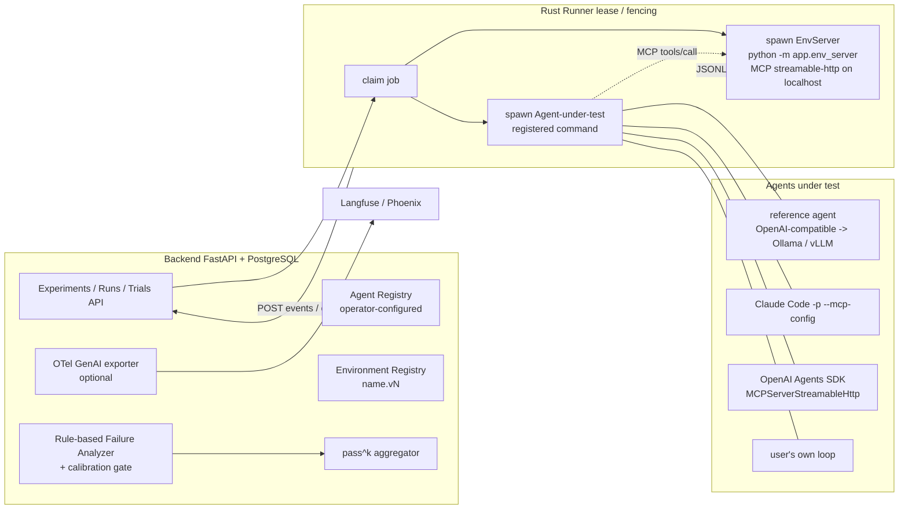

# AgentOps Workbench Roadmap

This file is the source of truth for engineering milestones. `CONTEXT.md` owns domain vocabulary and invariants; ADRs in `docs/adr/` own accepted architecture decisions. Executable implementation tracking lives in [docs/agents/phase2-tasks.md](docs/agents/phase2-tasks.md); local evidence is not a second tracker. Dated verification and closeout records live in [`docs/history/`](docs/history/).

## Direction (2026-10-17)

**Positioning:** A self-hosted agent reliability harness for operators who run local open-weight models (Ollama, vLLM) or other tool-using agents—run any registered agent-under-test in deterministic, resettable simulated tool environments, report pass^k, rule-based failure classification with calibration, and baseline-vs-candidate policy regression; traces export via OTel GenAI when enabled. The product name remains **AgentOps Workbench** (public rename is an open decision in H0-2).

**User profile:** Individuals or small teams who cannot send evaluation data to cloud SaaS and need comparable numbers across models, prompts, or agent scaffolds on the same environment.

**Retained assets:** Rust Runner lease/fencing, protocol v1, rule-based analyzer with the six-contract CI regression gate, replay/activate/reject loop, and three built-in environments (still exposed as `scenario_id` in protocol v1).

Trace UI, dataset versioning, trajectory assertions, replay diffs, and failed-run-to-regression workflows are commodity in Langfuse, Phoenix, Braintrust, and similar products; the industry is consolidating rather than expanding generic eval platforms. What remains scarce for self-hosted users is a reproducible harness that runs **external** agents against resettable environments, reports pass^k, exports OTel GenAI spans, and keeps a deterministic failure taxonomy with a calibration story. Phase 1 delivered a solid closed loop but coupled environment and agent in one class, so only the built-in Python agent could be evaluated. **The project no longer presents itself as a general evaluation platform.**

## Current state (2026-10-31)

Phase 1 hosted CI passed on `8bd2ef0`; its counts belong to that snapshot, not current H1. H1 integration now has separate Environment/MCP and registered fixture/reference Agent processes, production Rust dispatch/completion, trusted final checks, CP-owned scoring, canonical checkout/research/fault v2 plus `order-support.v1`, analyzer-v3 mechanics, and genuine Recorded Preview.

Local host/PostgreSQL, standard Runner network build, actual named-volume replacement, affected regressions, exact-payload checks and independent scoped reviews have parent evidence. The lock-path and exit-boundary P2s are repaired/reviewed. Local option-1 H1 engineering closeout is complete; release, hosted-CI, cold-cache, cross-platform and live-model claims remain explicitly outside this boundary. See [acceptance boundaries](docs/operations/system-acceptance.md).

The operator **explicitly deferred real-local-model trace/analysis acceptance**. Reference-Agent fake-Provider success is not Ollama/vLLM acceptance; Windows installation belongs to a separate operator-assigned Agent. No model download, Windows/network/firewall change, deployment, or H2 work is authorized by this closeout.

Not implemented: external CLI/SDK adapters (H2), trial groups/pass^k (H3), OTel GenAI export (H4), and the real-distribution agreement study (H5). Calibration remains `provisional_mechanics`, `publishable_accuracy=false`; self-labeling limits must be stated in any later study.

## Milestones

| Priority | Milestone | Status | Outcome |
|---|---|---|---|
| P0 | Phase 1.1 — Runner recovery | Complete | A crashed or disconnected Runner cannot strand a Run indefinitely. |
| P1 | Phase 1.2 — OpenAI-compatible provider | Complete | Real model execution uses the same supervised, typed, persisted workflow without making CI depend on an external API. |
| P2 | Phase 1.3 — Observability and operational hardening | Complete | Operators can diagnose queue, lease, Runner, provider, and migration failures from durable signals. |
| P1 | Phase 1.4 — Scenario onboarding | Complete | Operators choose from registered built-in Scenarios; the platform is no longer limited to one hard-coded demo. |
| P1 | Closed-loop depth follow-up | Complete | Failed Runs become classified, comparison-ready regression assets that gate policy activation. |
| P1 | Reliability and calibration hardening (2026-09 to 2026-10) | Complete | CAS/lock-order fixes, analyzer v2, six-contract calibration gate in CI; calibration redefined in Phase 2 H5. |
| P0 | Phase 2 — Harness H0 (facade and decisions) | In progress | ADRs, LICENSE, standards, learn map, and [task list](docs/agents/phase2-tasks.md) are in-repo. Still open: GitHub About, public name (H0-2). |
| P0 | Phase 2 — Harness H1 (Environment/Agent split) | Complete (local option-1 engineering boundary) | Split production path, Runner P2 repairs, affected regressions, standard image/volume validation and documentation are closed. Real-model acceptance explicitly deferred, not passed; hosted CI and release remain unestablished. |
| P1 | Phase 2 — Harness H2 (external agents) | Planned | Claude Code adapter required; Agents SDK / Codex optional. |
| P1 | Phase 2 — Harness H3 (trials and pass^k) | Planned | Trial groups, pass^k metrics, experiment summary UI. |
| P2 | Phase 2 — Harness H4 (OTel export) | Planned | OTLP GenAI projection, default off. |
| P2 | Phase 2 — Harness H5 (calibration study) | Planned | Analyzer regression gate unchanged; self-labeled agreement study on ~40 real runs. |
| P1 | Phase 2 — Harness H6 (packaging) | Planned | README, write-up, recorded demo. |
| Gate | Safety gate | Trigger-based | Required before side-effecting tools, untrusted users, or shared/public operation. |

Schedule: Phase 2 runs 2026-10-17 through approximately 2027-01-09 (12 weeks).

## Phase 2 — Harness

**Goal:** Turn the Phase 1 closed loop into a harness that evaluates registered external agents against deterministic environments, reports pass^k, exports traces to standard observability tools, and publishes a bounded calibration study—without building another generic eval platform UI.

This is the full Phase 2 target, not a current-capability diagram: H1 implements the Environment/registered-Agent pair; Trials, external adapters, pass^k and OTel remain later stages. Environments are MCP servers and capture world facts; Agents do not emit trusted JSONL.

### Decisions

- [ADR-0007](docs/adr/0007-environment-agent-split.md) — Split **Environment** (task, tools, state, assertions) from **agent-under-test** (`fixture`, `reference`, `external` kinds); protocol v1 keeps `scenario_id`.
- [ADR-0008](docs/adr/0008-environment-mcp-server-and-env-side-capture.md) — `app.env_server` as MCP Streamable HTTP with middleware capture, `submit_result`, Runner two-process supervision.
- [ADR-0009](docs/adr/0009-agent-registry-trust-boundary.md) — Operator TOML agent registry, `GET /api/agents`, `EvaluationSpec.agent_id`; Runner executes only registered argv commands.
- [ADR-0010](docs/adr/0010-trial-groups-and-pass-k.md) — Trial groups, fixed environment seed per group, pass^k via tau-bench estimator, group-aware policy validation.
- [ADR-0011](docs/adr/0011-otel-genai-export.md) — Post-terminal OTel GenAI span export (`AGENTOPS_OTEL_EXPORT=1`), `RunEvent` store remains source of truth.
- [ADR-0012](docs/adr/0012-h1-canonical-cutover-and-control-plane-success.md) (2026-10-24) — Approved one-time incompatible H1 cutover to the three canonical v2 defaults, retiring their v1 registrations/loops; Control Plane-only trusted-evidence success with registered aggregate >= version-fixed 1.0. `order-support.v1`, semantic identity, and human Policy gates remain unchanged. No migration, compatibility path, or data reset/deletion is authorized; validation uses fresh isolated data. H1-3 owns supervision; H1-5/integration wires evidence and completion. This records the contract; current local H1 Golden/PostgreSQL evidence is described in system acceptance, while live-model acceptance remains deferred.

- [ADR-0014](docs/adr/0014-h1-recorded-preview-canonical-events.md) — Genuine canonical Recorded Preview: ID/timestamp-only normalization, preserved accepted control, lifecycle chronology, no scoring changes.
- [ADR-0013](docs/adr/0013-h1-analyzer-v3-canonical-diagnostics.md) — Approved narrow H1 analyzer-v3 adaptation: run-level Agent-reported context diagnostics and no missing-tool planning attribution for pre-tool Provider failure. Six labels, scoring/success gates and calibration binding stay unchanged; fresh packets only, no historical rescoring.

### Stages

Executable tasks and acceptance criteria: [docs/agents/phase2-tasks.md](docs/agents/phase2-tasks.md). Standards: [docs/agents/development-standards.md](docs/agents/development-standards.md).

#### H0 — Facade and decisions (week 1)

- **Scope:** H0-1 LICENSE (MIT) and GitHub About/topics; H0-2 naming candidates (decision only); H0-3 ADR-0007–0011, ROADMAP/CONTEXT/README positioning; H0-4 calibration doc redefinition (text); H0-5 task list plus `docs/learn/00-map.md` and `glossary.md`.
- **Acceptance:** Accepted ADRs linked from living docs; Phase 1 marked complete; Phase 2 visible; no new product code required in H0. Remaining human steps: set the GitHub About text in H0-1, and choose a public name (H0-2). Neither blocks H1.
- **Learning deliverable:** `docs/learn/00-map.md`, `docs/learn/glossary.md`.

#### H1 — Environment/Agent split (weeks 2–4)

- **Scope:** H1-1 Environment protocol from built-in Scenarios; H1-2 `app.env_server` (MCP, env-side capture); H1-3 Runner dual subprocess supervision and `env_ready`; H1-4 `agent_id`, registry, `GET /api/agents`, New Experiment agent dropdown; H1-5 reference agent process (Ollama `qwen3:8b` default, vLLM documented); H1-6 stateful `order-support.v1`.
- **Diagnostic integration repair:** Implement ADR-0013's two analyzer-v3 rules and real `report_usage` calibration capture; retain all six fixed contracts and strict binding. This is not H5 research or new calibration mechanics.
- **Engineering closeout:** fixture Golden, fake-Provider reference Agent, trusted CP completion, recovery, standard-image/volume, affected regressions, documentation and final exact-payload review passed locally. Contract generation matches current models; preserve the unchanged dirty-index contract-gate disposition until an authorized delivery baseline.
- **Explicit deferral:** a real local reference-Agent trace/analysis remains unperformed by operator choice. Reopen only after an endpoint is supplied and approved; it is not replaced by fake-Provider evidence.
- **P2 amendment (ADR-0008):** no-follow/nonregular lock validation without target mutation; deterministic reader/Agent-exit barriers, incomplete-tail failure and direct-child reaping assertions. Both scoped reviews passed; affected image/runtime regression and five-repeat boundary validation are parent evidence.
- **Learning deliverable:** `docs/learn/01-run-lifecycle.md`, `docs/learn/02-environment-and-mcp.md`, `docs/learn/04-runner-lease-fencing.md`.

#### H2 — External agent adapters (weeks 5–6)

- **Scope:** H2-1 Claude Code adapter (required); H2-2 OpenAI Agents SDK adapter (optional); H2-3 Codex CLI adapter (optional); H2-4 plug-in guide.
- **Acceptance:** Same environment completed with reference agent and Claude Code; failure-class distribution documented.
- **Learning deliverable:** `docs/learn/03-plug-in-your-agent.md`.

#### H3 — Trial groups and pass^k (weeks 7–8)

- **Scope:** H3-1 trial group schema and `POST /api/experiments/{id}/trials`; H3-2 pass^k aggregation and group Before/After; H3-3 experiment page pass^1/pass^k summary (trace UI frozen).
- **Acceptance:** Real k=5 run on local model with numbers recorded; group policy validation rules per ADR-0010.
- **Learning deliverable:** `docs/learn/06-pass-k.md`.

#### H4 — OTel GenAI export (week 9)

- **Scope:** H4-1 `otel_export.py` mapping and OTLP/HTTP; H4-2 verification against Phoenix or Langfuse with pinned semconv commit in docs.
- **Acceptance:** Export off by default; on-demand and post-terminal export produce valid spans for a golden Run.
- **Learning deliverable:** `docs/learn/07-otel-mapping.md`.

#### H5 — Calibration redefined (weeks 10–11)

- **Scope:** H5-1 split [evaluation calibration](docs/evaluation-calibration.md) into analyzer regression gate (six controlled contracts, CI unchanged) and self-labeled agreement study; freeze new binding/hash/strict-mode mechanics; H5-2 ~40 real provider runs, author labels, published confusion matrix and bias notes (minimum 20 if cut line applies).
- **Acceptance:** CI six-contract gate still passes; public confusion matrix with documented limitations; no new accuracy ceremony code.
- **Learning deliverable:** `docs/learn/05-analyzer-and-calibration.md` and study artifact in `docs/`.

#### H6 — Packaging (week 12)

- **Scope:** H6-1 README (positioning, Ollama quickstart, architecture, pass^k numbers, why not Langfuse); H6-2 `docs/writeup.md`; H6-3 recorded demo refresh.
- **Acceptance:** README and write-up match shipped cut line; recorded demo covers harness path.
- **Learning deliverable:** README + `docs/writeup.md` (H6-1, H6-2).

### Cut line

Must ship within the 12-week window: **H0**, **H1**, **H2-1**, **H3**, **H6-1**, **H6-2**.

May defer or reduce: H2-2/H2-3 (keep at least one optional external adapter beyond H2-1 if time allows); H4; H5-2 to at least 20 labeled runs.

### Non-goals

Trace UI features, annotation queues, dataset management, multi-tenancy/auth, Kubernetes, containerised CLI agents, LLM-as-judge, training export, "platform" narrative, and new calibration binding/hash/strict-mode mechanics.

### Risks

- MCP Python SDK API drift — pin `mcp` minor version; isolate in `env_server`.
- Actual local GPU has about 12 GB VRAM, not the initial 16 GB assumption. `qwen3:8b` is a starting candidate; weights, KV cache, context and concurrency must be measured. Real-model acceptance is deferred.
- Claude Code adapter needs host credentials; H2-1 is required in the future cut line, but never a CI credential dependency.
- Environment-side capture misses agent internals — use `unknown` dimensions (existing analyzer behavior).
- Dual subprocess supervision complexity — Rust kill-semantics tests before feature work (H1-3).
- Scope creep — plan-outside work requires a new ADR and roadmap update first.

## Conditional safety gate

Before enabling side-effecting tools, user-supplied or untrusted external endpoints, untrusted accounts, or shared/public operation:

- Write a threat-model ADR.
- Add authentication, authorization, audit records, secret redaction, and resource limits.
- Define a PreToolUse decision boundary with explicit allow, block, and escalation semantics.
- Test SSRF, command injection, cross-tenant access, cancellation, and budget enforcement.

These controls are intentionally designed before those capabilities are enabled; they are not approximated by a misleading partial safety layer.

## Deferred until justified

Kubernetes execution, Docker socket access, containerised agent execution, vector memory, training export, arbitrary code execution, LLM-as-judge, multi-tenancy, billing, and automatic policy activation remain outside the active roadmap until a measured requirement promotes them.

MCP transport and agent adapters left this list on 2026-10-17 ([ADR-0008](docs/adr/0008-environment-mcp-server-and-env-side-capture.md), [ADR-0009](docs/adr/0009-agent-registry-trust-boundary.md)).

Before any trusted-intranet deployment, replace the Compose demo PostgreSQL credentials with an explicit secret source; keep demo defaults confined to an explicitly documented local-only profile.

When a deferred item is promoted, update this file, create or update a PRD in the git-ignored local tracker (not in the repository), and record any new architectural boundary in an ADR.

## History

- [Phase 1 verification log](docs/history/phase1-verification-log.md) — milestone and reliability/calibration closeout entries through 2026-10-15.
- [Calibration evidence log](docs/history/calibration-evidence-log.md) — calibration mechanics and evidence index.
