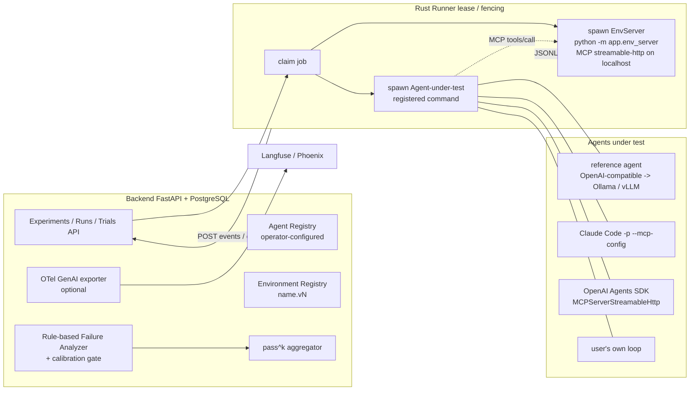

# AgentOps Workbench Roadmap

本文件是工程里程碑的事实来源。`CONTEXT.md` 负责领域词汇与不变量；`docs/adr/` 中的 ADR 负责已接受的架构决策。可执行任务只在 [docs/agents/phase2-tasks.md](docs/agents/phase2-tasks.md) 跟踪；本地证据不是第二 tracker。带日期的验证与收口记录见 [`docs/history/`](docs/history/)。

## 方向（2026-10-17）

**定位：** 面向运行本地开源模型（Ollama、vLLM）或其他工具型 Agent 的自托管 agent 可靠性 harness（可靠性试验台）——在确定性、可重置的模拟工具环境中运行任意已注册的 agent-under-test（被测 Agent），报告 pass^k、带校准的规则化失败分类，以及 baseline 与 candidate Policy 的回归对比；启用时通过 OTel GenAI 导出 trace。产品名称仍为 **AgentOps Workbench**（对外改名是 H0-2 中的开放决策）。

**用户画像：** 无法将评估数据发往云端 SaaS、需要在同一环境下对比模型、提示或 agent 脚手架的个人或小团队。

**保留资产：** Rust Runner 的 lease/fencing、协议 v1、带六合同 CI 回归门的规则化分析器、replay/activate/reject 闭环，以及三个内置环境（协议 v1 仍通过 `scenario_id` 暴露）。

到 2026-10，trace UI、数据集版本化、轨迹断言、replay 对比、失败 Run 转回归用例等已在 Langfuse、Phoenix、Braintrust 等产品中商品化；行业在整合而非扩张通用评估平台。对自托管用户仍稀缺的是：可对外部 Agent 可复现运行的 harness、可重置环境上的 pass^k、OTel GenAI 导出，以及确定性失败分类与校准叙事。Phase 1 交付了扎实闭环，但将环境与 Agent 耦合在一个类中，因此只能评估内置 Python Agent。**项目不再以通用评估平台自居。**

## 当前状态（2026-10-31）

Phase 1 hosted CI 在 `8bd2ef0` 通过，其计数只属于该历史快照。H1 已集成独立 Environment/MCP 与注册 fixture/reference Agent、生产 Rust dispatch/completion、可信 final-check、CP 独占评分、checkout/research/fault v2 与 `order-support.v1`、analyzer-v3 机制，以及真实 Recorded Preview。

本地 host/PostgreSQL、标准 Runner 网络构建、实际 named-volume 替换、受影响回归、exact-payload 检查与 scoped 独立审查已有父执行证据。lock-path 与 exit-boundary 两个 P2 已修复/复审。H1 本地工程与真实模型直连集成验收已完成；发布、hosted CI、cold-cache 和跨平台声明仍不在此边界内。见[验收边界](docs/operations/system-acceptance.md)。

H1-5 已使用已安装的 Windows llama.cpp 端点完成直连：新建 PostgreSQL 下 research/order 成功、checkout/fault 失败均保留，标准 Runner 镜像 research 也成功。四项 Runner-only 可选生成参数替代临时代理。见[验收记录](docs/history/h1-live-model-acceptance-2026-11-01.md)，不冒称 Ollama/vLLM、稳定通过率或分析器准确率。本轮不下载模型、不改 Windows/网络/防火墙、不公开部署、不启动 H2。

尚未实现：H2 CLI/SDK 适配器、H3 trial group/pass^k、H4 OTel GenAI export、H5 真实分布一致性研究。当前校准仍为 `provisional_mechanics`、`publishable_accuracy=false`；后续自标注研究必须披露方法局限。

## 里程碑

| 优先级 | 里程碑 | 状态 | 结果 |
|---|---|---|---|
| P0 | Phase 1.1 — Runner recovery | 已完成 | Runner 崩溃或失联后 Run 不会永久卡住。 |
| P1 | Phase 1.2 — OpenAI-compatible provider | 已完成 | 真实模型走同一套受监督、有类型、可持久化流程，CI 不依赖外部 API。 |
| P2 | Phase 1.3 — 可观测性与运维加固 | 已完成 | 可依持久信号诊断队列、lease、Runner、Provider 与迁移故障。 |
| P1 | Phase 1.4 — 场景接入 | 已完成 | 从注册内置 Scenario 中选择；不再局限于硬编码 demo。 |
| P1 | 闭环深化后续 | 已完成 | 失败 Run 成为可归类、可对比的回归资产并门禁 Policy 激活。 |
| P1 | 可靠性与校准加固（2026-09 至 2026-10） | 已完成 | CAS/锁顺序修复、analyzer v2、CI 六合同校准门；校准在 Phase 2 H5 重定义。 |
| P0 | Phase 2 — Harness H0（门面与决策） | 进行中 | ADR、LICENSE、规范、学习地图和[任务清单](docs/agents/phase2-tasks.md)已在仓库内。仍开放：GitHub About、对外名称（H0-2）。 |
| P0 | Phase 2 — Harness H1（Environment/Agent 拆分） | 完成（本地工程 + 真实模型集成） | 独立进程路径、P2 修复、确定性回归、标准镜像/volume 与直连 reference Agent trace/分析已验收。模型失败保留；hosted CI 与发布仍未建立。 |
| P1 | Phase 2 — Harness H2（外部 Agent） | 计划中 | Claude Code 适配器必做；Agents SDK / Codex 可选。 |
| P1 | Phase 2 — Harness H3（trial 与 pass^k） | 计划中 | Trial group、pass^k 指标、Experiment 摘要 UI。 |
| P2 | Phase 2 — Harness H4（OTel 导出） | 计划中 | OTLP GenAI 投影，默认关闭。 |
| P2 | Phase 2 — Harness H5（校准研究） | 计划中 | 分析器回归门不变；约 40 条真实 Run 的自标注一致性研究。 |
| P1 | Phase 2 — Harness H6（打包） | 计划中 | README、write-up、recorded demo。 |
| Gate | 安全门 | 条件触发 | 启用有副作用工具、不可信用户或共享/公网运行前必须完成。 |

时间表：Phase 2 为 2026-10-17 至约 2027-01-09（12 周）。

## Phase 2 — Harness

**目标：** 将 Phase 1 闭环变为可评估已注册外部 Agent 的 harness，报告 pass^k，向标准可观测性工具导出 trace，并发布有界的校准研究——不再建设另一套通用评估平台 UI。

此图是完整 Phase 2 目标，不是当前能力清单：H1 实现 Environment/注册 Agent 双进程；Trials、外部适配器、pass^k 和 OTel 属于后续阶段。工具事实由 MCP Environment 采集，Agent 不发可信 JSONL。

### 决策

- [ADR-0007](docs/adr/0007-environment-agent-split.md) — 拆分 **Environment**（任务、工具、状态、断言）与 **agent-under-test**（`fixture`、`reference`、`external`）；协议 v1 保留 `scenario_id`。
- [ADR-0008](docs/adr/0008-environment-mcp-server-and-env-side-capture.md) — `app.env_server` 为 MCP Streamable HTTP，middleware 采集、`submit_result`、Runner 双进程监督。
- [ADR-0009](docs/adr/0009-agent-registry-trust-boundary.md) — 运维 TOML Agent 注册表、`GET /api/agents`、`EvaluationSpec.agent_id`；Runner 只执行已注册 argv。
- [ADR-0010](docs/adr/0010-trial-groups-and-pass-k.md) — Trial group、组内固定环境 seed、tau-bench 估计 pass^k、组级 Policy 校验。
- [ADR-0011](docs/adr/0011-otel-genai-export.md) — 未来 H4 OTel GenAI 导出，`RunEvent` 仍为事实源。
- [ADR-0012](docs/adr/0012-h1-canonical-cutover-and-control-plane-success.md) — H1 规范 v2 不兼容切换、CP 可信证据和 aggregate 成功门；不授权历史迁移、重评分或删除。
- [ADR-0013](docs/adr/0013-h1-analyzer-v3-canonical-diagnostics.md) — 两项有界 v3 诊断修订，保持评分和校准绑定。
- [ADR-0014](docs/adr/0014-h1-recorded-preview-canonical-events.md) — 真实 v2 Recorded Preview、保留 accepted control、生命周期时间戳，不改评分。

### 阶段

可执行任务与验收： [docs/agents/phase2-tasks.md](docs/agents/phase2-tasks.md)。规范： [docs/agents/development-standards.md](docs/agents/development-standards.md)。

#### H0 — 门面与决策（第 1 周）

- **范围：** H0-1 LICENSE（MIT）与 GitHub About/topics；H0-2 命名候选（仅决策）；H0-3 ADR-0007–0011、ROADMAP/CONTEXT/README 定位；H0-4 校准文档重定义（文字）；H0-5 任务清单与 `docs/learn/00-map.md`、`glossary.md`。
- **验收：** 已接受 ADR 链入 living docs；Phase 1 标完成；Phase 2 可见；H0 不要求新产品代码。剩下的人工步骤：按 H0-1 改 GitHub About，并选定对外名称（H0-2）。两者都不阻塞 H1。
- **学习交付物：** `docs/learn/00-map.md`、`docs/learn/glossary.md`。

#### H1 — Environment/Agent 拆分（第 2–4 周）

- **范围：** H1-1 从内置 Scenario 抽出 Environment 协议；H1-2 `app.env_server`（MCP、环境侧采集）；H1-3 Runner 双子进程监督与 `env_ready`；H1-4 `agent_id`、注册表、`GET /api/agents`、新建 Experiment 的 Agent 下拉；H1-5 参考 Agent 进程（默认 Ollama `qwen3:8b`，文档化 vLLM）；H1-6 有状态 `order-support.v1`。
- **工程收尾：** fixture Golden、fake-Provider reference Agent、可信 CP completion、恢复、标准镜像/volume、受影响回归、文档及最终 exact-payload 审查已在本地完成。原契约 gate 已在提交后的 canonical v2 基线上通过；旧 dirty-index 结果作为历史保留。
- **H1-5 收尾（2026-11-01）：** 真实 llama.cpp 直连、四项有界 Runner-only 生成参数（ADR-0003 修订）、可重复采集命令与 trace/分析已完成。失败不修补，CI 仍只用 fixture/fake Provider，H2 不启动。
- **P2 修订（ADR-0008）：** lock no-follow/非普通文件拒绝且不修改目标；reader/Agent-exit barrier、残留半行失败和自主回收断言。两个 scoped 复审通过；受影响镜像/runtime 回归及五次边界重复验证已有父执行证据。
- **学习交付物：** `docs/learn/01-run-lifecycle.md`、`docs/learn/02-environment-and-mcp.md`、`docs/learn/04-runner-lease-fencing.md`。

#### H2 — 外部 Agent 适配器（第 5–6 周）

- **范围：** H2-1 Claude Code 适配器（必做）；H2-2 OpenAI Agents SDK 适配器（可选）；H2-3 Codex CLI 适配器（可选）；H2-4 接入指南。
- **验收：** 同一环境下参考 Agent 与 Claude Code 各完成一次；记录失败类型分布。
- **学习交付物：** `docs/learn/03-plug-in-your-agent.md`。

#### H3 — Trial group 与 pass^k（第 7–8 周）

- **范围：** H3-1 trial group  schema 与 `POST /api/experiments/{id}/trials`；H3-2 pass^k 聚合与组级 Before/After；H3-3 Experiment 页 pass^1/pass^k 摘要（trace UI 冻结）。
- **验收：** 本地模型真实 k=5 运行并记录数字；组级 Policy 校验符合 ADR-0010。
- **学习交付物：** `docs/learn/06-pass-k.md`。

#### H4 — OTel GenAI 导出（第 9 周）

- **范围：** H4-1 `otel_export.py` 映射与 OTLP/HTTP；H4-2 对 Phoenix 或 Langfuse 验证并在文档 pin semconv commit。
- **验收：** 默认关闭；按需与终态导出对 golden Run 产生合法 span。
- **学习交付物：** `docs/learn/07-otel-mapping.md`。

#### H5 — 校准重定义（第 10–11 周）

- **范围：** H5-1 将 [evaluation calibration](docs/evaluation-calibration.md) 拆为分析器回归门（六受控合同，CI 不变）与自标注一致性研究；冻结新 binding/hash/strict-mode 机制；H5-2 约 40 条真实 Provider Run、作者标注、公开混淆矩阵与偏差说明（切割线下至少 20 条）。
- **验收：** CI 六合同门仍通过；公开混淆矩阵并说明局限；不新增准确率仪式代码。
- **学习交付物：** `docs/learn/05-analyzer-and-calibration.md` 与 `docs/` 中的研究产物。

#### H6 — 打包（第 12 周）

- **范围：** H6-1 README（定位、Ollama quickstart、架构、pass^k 数字、为何不是 Langfuse）；H6-2 `docs/writeup.md`；H6-3 recorded demo 刷新。
- **验收：** README 与 write-up 与切割线一致；recorded demo 覆盖 harness 路径。
- **学习交付物：** README + `docs/writeup.md`（H6-1、H6-2）。

### 切割线

12 周内必须交付：**H0**、**H1**、**H2-1**、**H3**、**H6-1**、**H6-2**。

可推迟或缩减：H2-2/H2-3（时间允许时保留 H2-1 之外至少一个可选外部适配器）；H4；H5-2 至少 20 条标注。

### 非目标

trace UI 新功能、标注队列、数据集管理、多租户/鉴权、Kubernetes、容器化 CLI Agent、LLM-as-judge、training export、“平台”叙事，以及新的 calibration binding/hash/strict-mode 机制。

### 风险

- MCP Python SDK API 漂移 — pin `mcp` 小版本；集中在 `env_server`。
- 实际本地主机约 12 GB VRAM，不是最初假设的 16 GB。`qwen3:8b` 仍是未实测候选；已测 Swift/llama.cpp 显存余量很小，不能推广为普遍适配或稳定性保证。
- Claude Code 适配器依赖主机凭据；H2-1 是未来切割线必做项，但不成为 CI 凭据依赖。
- 环境侧采集缺少 Agent 内部信息 — 使用 `unknown` 维度（现有分析器行为）。
- 双进程监督复杂度 — H1-3 先写 Rust kill 语义测试。
- 范围膨胀 — 计划外工作须先新 ADR 并更新本 roadmap。

## 条件安全门

在启用有副作用工具、由用户提供或不可信的外部地址、不可信账户或共享/公网运行前：

- 编写威胁模型 ADR。
- 增加认证、授权、审计记录、Secret 脱敏和资源限制。
- 定义具有明确 Allow、Block、Escalate 语义的 PreToolUse 决策边界。
- 测试 SSRF、命令注入、跨租户访问、取消与预算限制。

这些控制应在相关能力启用前被完整设计，不能用不完整的“安全层”制造虚假安全感。

## 暂缓能力

Kubernetes 执行、Docker Socket、容器化 Agent 执行、向量记忆、training export、任意代码执行、LLM-as-judge、多租户、计费与 Policy 自动激活，在出现可量化需求前仍不在活跃 roadmap 中。

MCP transport 与 Agent 适配器已于 2026-10-17 从此列表移除（[ADR-0008](docs/adr/0008-environment-mcp-server-and-env-side-capture.md)、[ADR-0009](docs/adr/0009-agent-registry-trust-boundary.md)）。

在任何可信内网部署前，将 Compose 演示用 PostgreSQL 凭据替换为显式 Secret 来源；演示默认值只能留在明确标注的本地 profile。

暂缓项进入主线时，应更新本文件、在 git 忽略的本地 tracker（不在仓库中）新建或更新 PRD，并通过 ADR 记录新架构边界。

## 历史

- [Phase 1 验证记录](docs/history/phase1-verification-log.zh-CN.md) — 截至 2026-10-15 的里程碑与可靠性/校准收口条目。
- [校准证据记录](docs/history/calibration-evidence-log.md) — 校准机制与证据索引。
