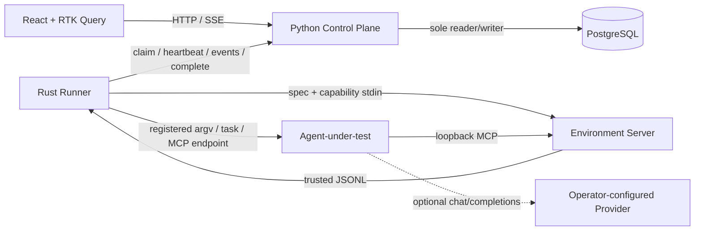

# AgentOps Closed-Loop Architecture

Current integration: Phase 1 workflow + H1 Environment/Agent split. Final delivery acceptance is separate; see [system acceptance](operations/system-acceptance.md). This document explains ownership, not task status; [phase2-tasks.md](agents/phase2-tasks.md) is the task source of truth.

## One Run

```text
Experiment → Baseline → Persisted Trace → Analysis → Candidate Policy
           → Replay → Comparison → Human Activate or Reject
```



1. CP validates Environment, optional Agent ID and parameters; creates immutable EvaluationSpec, queued Run and RunnerJob.
2. Rust claims with a lease/Attempt and starts an outer deadline before launching children. It opens the protected per-Run capability record under validated locks.
3. Runner starts `app.env_server`, writes the spec/capability, and waits for `env_ready`. Readiness has no raw capability and is not a durable RunEvent.
4. Runner resolves operator TOML argv and starts the independent Agent in the shared process group. API requests never carry executable commands or Provider settings.
5. Agent discovers and calls MCP tools. Environment owns state, deterministic observations, faults, controls, and bounded final-check operands. It emits trusted facts; Agent stdout remains bounded diagnostics.
6. Runner relays Environment events with lease, Attempt and contiguous global sequence. CP validates raw provenance before normalization, persists facts, then publishes SSE.
7. Runner reports `ExecutionFacts`, not an authoritative terminal event. CP locks Job → Run and alone validates current-Attempt evidence, scores registered assertions and commits terminal state/effects.
8. Runner validates the completion wrapper's Run/Attempt, terminal identity, booleans and positive persisted terminal sequence before deleting the capability. HTTP 200/EOF/local eligibility is insufficient.
9. A failed baseline may yield a bounded candidate Policy and RegressionCase. Replay retains Environment, Agent, seed, task, mode and limits, adding only the candidate patch and new identity.
10. Positive successful replay and eligible case replays gate validation; activation still needs a second explicit human action after reviewing results. No automatic activation.

## Ownership and source map

| Boundary | Owns | Read next |
|---|---|---|
| React | Workflow presentation; RTK Query server cache, Redux cross-route state, page-local ephemeral state | `frontend/src/Phase1App.tsx`, `frontend/src/services/` |
| Python CP | PostgreSQL, immutable specs, leases, state machines, scoring, analysis, policy and maintenance | `backend/app/phase1_main.py`, `phase1_service.py` |
| Rust Runner | Process groups, startup-inclusive supervision, bounded framing/output, heartbeat/retry/cancel, ACK validation | `runner/crates/agentops-runner/src/lib.rs` |
| Environment | Tools, world state/faults, assertions declaration, observed-call capture, submit/check facts | `backend/app/environment.py`, `env_server.py`, `scenarios/` |
| Agent-under-test | Decisions, MCP client and optional Provider loop; no world rules/persistence/scoring | `fixture_agent.py`, `reference_agent.py`, `mcp_agent_client.py` |
| Registries | CP world allowlist and operator-owned Agent argv allowlist | `scenario_registry.py`, `agent_registry.py`, `config/agents.toml`, Rust `registry.rs` |
| Contracts | Python-owned protocol v1 schemas, Rust Serde and TypeScript Zod consumers | `phase1_schemas.py`, `contracts/v1/` |
| Diagnostics | Deterministic analyzer-v3, unknown-aware calibration mechanics | `failure_analyzer.py`, `calibration_review.py`, `calibration_report.py` |
| Recorded Preview | Replay of actual persisted canonical facts; no duplicate business rules | `frontend/src/services/recorded/`, `scripts/record_golden_fixture.py` |

`backend/app/main.py` exposes `phase1_main.py`; the `phase1` module names do not imply the production path still uses the old coupled Agent. Historical demo/test helpers are not a production fallback.

## World and Agent identities

Current worlds: `checkout-api-latency.v2`, `multi-step-research.v2`, `api-fault-orchestration.v2`, `order-support.v1`. The three retired world v1 IDs fail closed; protocol `schema_version=1` and Agent `.v1` identities are different version axes. No aliases, historical migration/rescoring, or automatic deletion are authorized (ADR-0012).

Normal Agents: `fixture-agent.v1` and `reference-openai-compatible.v1`. Omission selects by execution mode; an explicit ID wins and unknown explicit IDs never fall back to the break-glass override. `recovery-fixture.v1` belongs only to the explicit gate registry, not the normal product registry or H2.

World tool surfaces and assertion onboarding: [contributor guide](agents/scenario-development.md). Agent deployment: [registry runbook](operations/agent-registry.md).

## Success and evidence

CP requires valid same-Attempt submission/check, sufficient valid trusted final-check evidence, registered suite aggregate `>= 1.0`, and no abnormal execution failure. Assertion combination stays `ALL=min`, `ANY=max`, `WEIGHTED=weighted mean`, with registered thresholds. Quality-score penalties and Agent/check-reported scores do not decide success.

The scoring trajectory includes all persisted world attempts, including rejected calls represented as `rejected_tool`/failed sentinels; controls are excluded. Final outcomes use bounded Environment-owned `scenario_id` and `final_observation`, checked against CP expectations. The order refund's exactly-once proof is its final ledger, not request count. Missing usage is unknown; reported usage is Agent-reported, not inferred measurement.

`submit_result` is retained as empty-argument durable control provenance but not a scored world call. Recorded Preview preserves exactly one accepted finalization and actual nullable telemetry; only IDs and deterministic timestamps inside Run lifetime are normalized (ADR-0014).

## Recovery and local trust

- Job locks fence heartbeat/event/completion against recovery; terminal CAS/effects happen only once. Event retries converge, conflicts/gaps stay explicit.
- Expiry permits a new Attempt, not two owners. Accepted events remain immutable; analysis/scoring uses the latest Attempt. Same logical Run reuses one capability; a new Environment/endpoint starts per Attempt.
- Compose mounts the capability handoff volume. Directory uid 10001/mode 0700 and records mode 0600 are checked; capability values do not enter logs or events.
- Capacity/per-Run lock opens atomically reject symlinks, validate regular-file descriptors/owner/mode, and never truncate. The directory/host is trusted; this is not malicious same-user isolation.
- Four output streams share a bounded total. One cancellation-safe JSONL reader retains prefixes across main/final phases; a retained incomplete tail cannot become eligible even after accepted submit. Clean EOF or unexpected natural Environment exit is not planned teardown.
- TERM → shared two-second grace → KILL is child-group cleanup. A healthy Environment may be deliberately torn down after valid facts; that exception never overrides timeout, cancellation, lease/output failure or abnormal Agent/Environment failure.
- Simultaneously ready `select!` failures are not a proven universal precedence order. Tests prove specific barriers/outcomes, not exhaustive schedules/platforms. Runner daemon shutdown is separate from child-group cleanup; historical bounded Compose stop exit 137 does not establish graceful daemon termination.

See [ADR-0002](adr/0002-runner-recovery.md), [ADR-0008](adr/0008-environment-mcp-server-and-env-side-capture.md), and [Chinese lifecycle chapter](learn/01-run-lifecycle.md).

## Diagnostics and acceptance limits

ADR-0013 changes only run-level explicit context evidence (strictly above 95%, Agent-reported) and suppresses assertion-derived planning for zero-world-call explicit Provider failure. Scoring, labels and terminal gates are unchanged. Fresh v3 packets bind actual event/trajectory facts; historical packets are not relabeled. Six controlled contracts plus real PostgreSQL dump/restore remain `provisional_mechanics`, `publishable_accuracy=false`, not general accuracy.

Host tests, ASGI calibration, standard network builds, offline-derived images, actual volume replacement, browser recording, hosted CI and live models establish different things. Current operator choice explicitly defers real-local-model acceptance and installation to a separate task. Fake Providers cannot satisfy it. Procedures: [validation](operations/reliability-and-local-validation.md), [calibration](evaluation-calibration.md), [local-model handoff](operations/local-model.md).

## Future architecture, not current features

- **H2:** external Claude/SDK/CLI adapters attached to the same MCP world.
- **H3 / ADR-0010:** trial groups, unbiased pass^k, group-aware Policy validation and Experiment summary.
- **H4 / ADR-0011:** optional lossy OTel GenAI projection; RunEvent stays authoritative.
- **H5:** author-labeled real-run agreement study with stated biases.

These accepted decisions do not mean those modules ship. No H2 work is included in H1 closeout. Kubernetes, Docker socket execution, untrusted code, multi-tenancy, training export, automatic activation, and broader side effects still require a measured need and the [roadmap safety gate](../ROADMAP.md#conditional-safety-gate).
