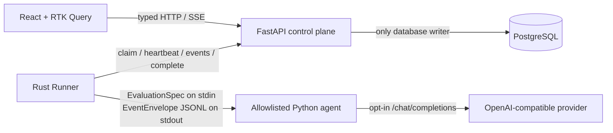

# AgentOps Closed-Loop Architecture

Status: current for Phase 1
Last reviewed: 2026-10-15

## System goal

AgentOps evaluates one agent configuration, explains a failed run, proposes a bounded policy change, replays the same evaluation input, and leaves activation to a person:

```text
Experiment → Baseline → Persisted Trace → Failure Analysis
           → Candidate Policy → Replay → Comparison → Human Activate or Reject
```

The current system is a focused evaluation control plane, not a generic orchestration platform. `backend/app/main.py` exports the Phase 1 application from `phase1_main.py`. Pre-Phase 1 executor, auto-replay, MCP, memory, and export modules have been removed from the tree. Future work is tracked in [ROADMAP.md](../ROADMAP.md).

## Implemented Phase 1

| Capability | Current implementation | Source of truth |
|---|---|---|
| Domain workflow | Experiment, baseline/replay Run, analysis, RegressionCase, candidate/active Policy | `backend/app/phase1_service.py` |
| API and state transitions | Typed FastAPI routes and explicit errors | `backend/app/phase1_main.py` |
| Persistence | PostgreSQL models and Alembic migration | `backend/app/phase1_models.py`, `backend/alembic/` |
| Execution protocol | Versioned EvaluationSpec and EventEnvelope | `backend/app/phase1_schemas.py`, `contracts/v1/` |
| Process supervision | Rust claim/heartbeat loop, process groups, timeout, cancellation, bounded JSONL | `runner/crates/agentops-runner/` |
| Python agent | Registered Scenario handlers with deterministic fixture and narrow Provider paths | `backend/app/scenarios/`, `backend/app/phase1_provider.py` |
| Product workflow | Experiments, Trace, deterministic Analysis, persisted comparisons, regression replay, activate/reject | `frontend/src/Phase1App.tsx` |
| Offline regression adapter | Recorded persisted facts validated through the frontend contract | `frontend/src/services/recorded/` |
| Evaluation calibration | Read-only analysis-blind packets and bound reports over persisted terminal RunEvents; independent human-label accuracy remains gated | `backend/app/calibration_review.py`, `backend/app/calibration_report.py` |
| End-to-end verification | Real Compose stack, Golden loop, and Runner recovery fault test | `infra/docker/docker-compose.phase1.yml`, `scripts/golden_e2e.py`, `scripts/recovery_e2e.py` |

## Component ownership



- React owns workflow presentation and client state. It does not score, compile policies, or advance server state machines.
- FastAPI owns domain state, leases, persistence, scoring, analysis, and policy decisions. It does not supervise child processes.
- The Rust Runner owns process lifecycle, bounded transport, retry, cancellation, and timeout. It does not access PostgreSQL or implement policy logic.
- PostgreSQL stores durable facts; SSE is a projection of committed RunEvents.
- The Python agent consumes an immutable EvaluationSpec and emits protocol events. In provider mode it may call only the operator-configured OpenAI-compatible endpoint and the selected Scenario's explicit tool definitions; it does not own Run lifecycle state.

## Closed-loop behavior

1. A user creates an Experiment with a registered, versioned Scenario and either fixture or provider execution mode.
2. FastAPI creates a queued baseline Run and RunnerJob.
3. A Rust Runner claims the Job under a lease and supervises the fixture or provider-backed Python agent.
4. FastAPI validates and commits ordered events before notifying SSE clients.
5. Terminal processing calculates score and deterministic failure analysis with controlled failure types and metric directions.
6. A failed baseline produces a bounded candidate PolicyPatch.
7. A person may preserve a failed Run as a RegressionCase. Fixture cases are deterministic replay gates; Provider cases record the external-model reproducibility boundary and remain analysis-only.
8. A person starts Replay; the same scenario, task, seed, and limits are retained while the candidate patch is added. Improve compares persisted score, analysis, trajectory, latency, and token facts.
9. A successful positive Replay validates the candidate. The first activation request queues any missing eligible RegressionCase replays without activating the Policy.
10. A person reviews the regression results and explicitly activates again or rejects the Policy. No policy activates automatically.

The registry contains `checkout-api-latency.v1`, `multi-step-research.v1`, and
`api-fault-orchestration.v1`. Each Scenario retains its own allowlisted tools,
fixture semantics, and terminal assertions within this same workflow. The
[Scenario contributor guide](agents/scenario-development.md) describes their
versioning and assertion contract; `scripts/golden_e2e.py` covers all three.

## Reliability properties already enforced

- `run_id + sequence` is unique and duplicate event uploads are idempotent.
- Repeated replay requests and repeated terminal completion return the existing result.
- RegressionCase creation is unique per source Run; concurrent creators converge on one persisted case.
- Policy replay atomically claims `replay_run_id`; concurrent requests converge on one Replay Run and RunnerJob.
- Terminal completion compares and sets the observed Run status; only the winner executes terminal scoring, analysis, and candidate-policy side effects.
- Lease-bearing RunnerJob writes lock the lease row; recovery cannot interleave an old heartbeat, event upload, or completion with a new Attempt.
- Each Policy must pass eligible RegressionCases against its own patch; a terminal replay owned by another Policy is replaced before activation.
- Competing Policy activations lock the Experiment row before superseding and activating, preserving one active Policy without an IntegrityError response.
- Runner endpoints authenticate the Runner and validate lease ownership.
- Expired leases cannot append events or mutate non-terminal Runs.
- Commands and arguments remain separate; API clients cannot submit an executable or shell command.
- JSONL line and combined-output limits are bounded.
- Linux/WSL child processes run in their own process group and receive SIGTERM before SIGKILL.
- Protocol v1 fixtures are validated by Python and Rust; frontend live and recorded paths share Zod schemas.
- Provider metadata is projected from latest-attempt events into Run metrics; credentials, endpoint values, and hidden reasoning are not persisted.
- Regression replays use normal Runs and RunnerJobs but cannot overwrite the Policy's primary replay score delta or validation status.
- Retention treats RegressionCases as part of the Experiment aggregate and blocks cross-aggregate references before deletion.
- Calibration review packets are analysis-blind: they omit scores, stored analysis, and raw Provider output, while retaining enough execution metadata that they must not be presented as outcome-blind or double-blind evidence.
- Recorded Preview replays persisted facts for offline development and regression testing; it does not reproduce backend business logic or provider calls.

## Known boundary

Runner recovery, registered Scenarios, and the narrow Provider boundary are implemented. Provider mode remains deliberately constrained: endpoint, model, and credential are Runner-only operator configuration; the model can choose only the selected Scenario's explicit tool definitions; live calls are opt-in; and CI uses deterministic fixtures plus local fake compatible servers.

The next milestone targets a single machine or trusted team network. It prioritizes state-machine reliability and evaluation accuracy; throughput and multi-user collaboration remain deferred. See [ROADMAP.md](../ROADMAP.md) for the promotion gates.

The [roadmap](../ROADMAP.md) and [calibration procedure](evaluation-calibration.md)
record dated verification evidence. On 2026-10-15, the standard Runner build
completed and an isolated standard four-service stack passed all three Golden
Scenarios and Runner kill/replacement recovery. Runner/API Python hashes matched
the final sources, with no source mounts. Base images and API/Web layers used
Docker cache; Runner Rust compilation and pinned Python dependency installation
completed before the final source refresh reused those layers. Current backend
verification passes 225 tests including PostgreSQL checks, with no skips; Linux
Node 22 passes formatting, typecheck, 27 unit tests, build, production dependency
audit, and two Recorded E2E tests. This is local evidence, not a new hosted CI
result. The [local validation runbook](operations/reliability-and-local-validation.md)
records toolchain, cache, proxy, and build boundaries.

The current six-case controlled capture supplements the fixture sample with
injected context pressure/low-use/unknown measurements and loopback Fake
Provider success/timeout/invalid-response cases. It uses authenticated ASGI
Runner API persistence, independently of the standard-stack verification above;
it does not exercise Rust supervision or external models. Zero-step Provider
execution failures now project their execution evidence into dimensions and
dominant; this semantic fix uses `failure-analyzer.v2`, requiring new strict
packets rather than relabeling historical v1 reports.

The bound report remains provisional engineering evidence with
`publishable_accuracy=false`. Agent-authored input contracts and correlated
fixtures cannot establish general accuracy; missing context measurements are
not confirmed negatives. Independent human labels and adjudication remain a
separate publication gate and do not block deterministic engineering work.

## Deliberately deferred

Kubernetes execution, Docker socket access, MCP transport, vector memory, training export, framework adapters, arbitrary code execution, accounts, multi-tenancy, billing, side-effecting tools, and automatic policy activation are not part of the active architecture. Promotion requires a measured need, a roadmap update, and an ADR when trust boundaries change.
